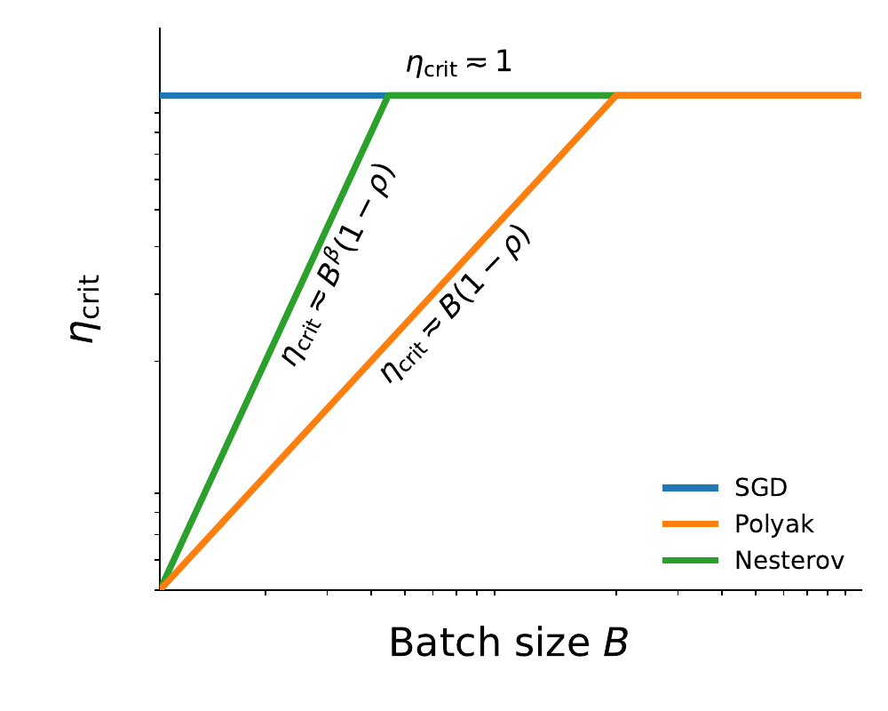
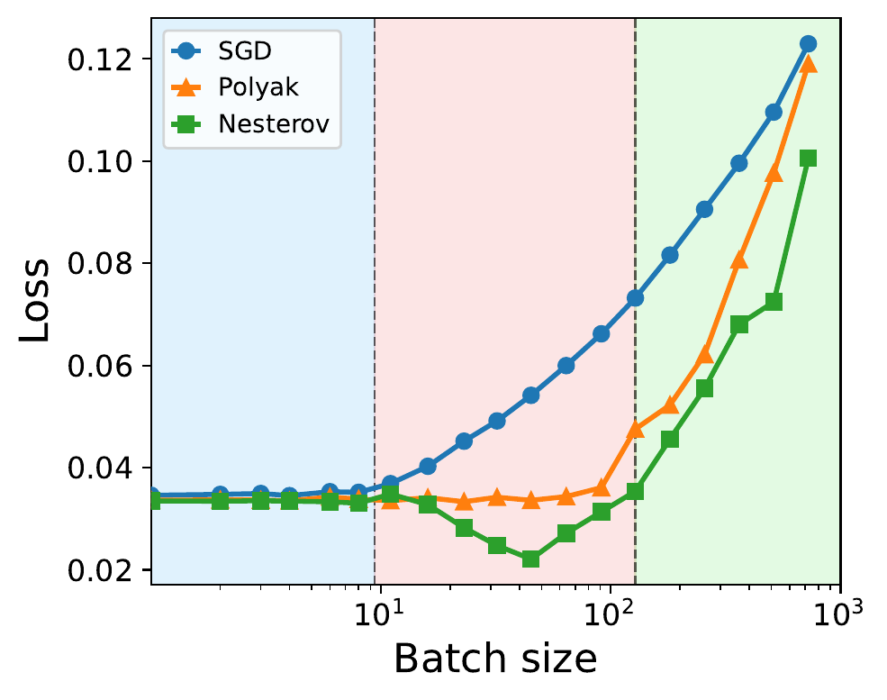
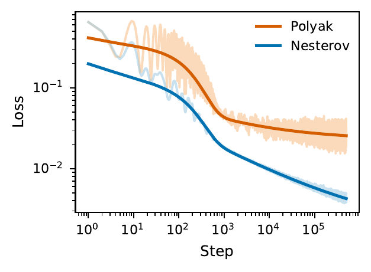

# From Polyak to Nesterov: Landscape-Aware Momentum Methods May Improve Stability and Data Scaling

<p align="center">
  <a href="#introduction">📖 Introduction</a> •
  <a href="#main-results">📊 Main Results</a> •
  <a href="#experiments">🧪 Experiments</a> •
  <a href="#getting-started">🚀 Getting Started</a>
</p>

<a id="introduction"></a>

## 📖 Introduction

Momentum is a central ingredient in modern optimization, but its interaction with stochastic gradient noise and spectral structure is still not fully understood. Classical theory explains acceleration in deterministic settings, while offering a less complete picture of why Polyak and Nesterov momentum can behave differently in mini-batch training.

In this work, we study **SGD**, **Polyak heavy-ball momentum**, and **Nesterov momentum** in power-law kernel regression with Gaussian features. This model provides a tractable multi-scale learning problem in which the spectrum, target smoothness, gradient noise, and momentum dynamics can be analyzed together. The feature covariance spectrum and target obey

$$
\lambda_j \asymp j^{-\beta}, \qquad
\lambda_j |\theta_j^*|^2 \asymp j^{-(1+s\beta)},
$$

where $\beta>1$ is the capacity exponent and $s>0$ is the source exponent. Smaller $s$ places more target energy in low-curvature directions and therefore corresponds to a harder learning problem.

Our analysis connects mean-square stability with data scaling under a fixed budget $D=BK$, where $B$ is the batch size and $K$ is the number of optimization steps. It shows that Polyak momentum mainly enlarges the useful batch-size range, whereas Nesterov momentum can improve the optimal data-scaling exponent through curvature-dependent damping of stochastic noise.

This repository contains a unified PyTorch implementation of the numerical experiments. CPU, CUDA, and Apple Silicon runs share the same model and optimizer code; `--device` only selects the compute backend.

<a id="main-results"></a>

## 📊 Main Results

### 1. Stochastic Stability Boundaries

| Method | Critical learning rate |
|---|---|
| SGD | $\eta_{\mathrm{stab}}\asymp 1$ |
| Polyak | $\eta_{\mathrm{stab}}\asymp \min\{1,B(1-\rho)\}$ |
| Nesterov | $\eta_{\mathrm{stab}}\asymp \min\{1,B^\beta(1-\rho)\}$ |

Nesterov's look-ahead correction makes its stable region grow faster with batch size, allowing it to reach the deterministic stability ceiling earlier than Polyak momentum.

### 2. Excess-Risk Scaling Laws

The expected excess risk admits a signal-learning and noise-accumulation decomposition:

$$
\mathbb{E}[\mathcal E(\theta_k)]
\asymp
\mathcal D(k)
+
\frac{\eta^2}{B}
\sum_{m=0}^{k-1}
\mathcal K(k-1-m)
(\mathbb{E}[\mathcal E(\theta_m)]+\sigma^2),
$$

where $\mathcal D(k)$ describes how the target signal is learned and $\mathcal K(\tau)$ describes how long stochastic noise remains in the dynamics. In the noisy setting, the leading long-time terms are

$$
\begin{aligned}
\text{SGD:}\qquad
\mathbb{E}[\mathcal E(\theta_k)]
&\asymp
(\eta k)^{-s}
+
\frac{\eta\sigma^2}{B},\\
\text{Polyak:}\qquad
\mathbb{E}[\mathcal E(\theta_k)]
&\asymp
(\frac{1-\rho}{\eta k})^s
+
\frac{\eta\sigma^2}{B(1-\rho)},\\
\text{Nesterov:}\qquad
\mathbb{E}[\mathcal E(\theta_k)]
&\asymp
(\frac{1-\rho}{\eta k})^s
+
\frac{\sigma^2}{B}
\min\{
\frac{\eta}{1-\rho},
(\frac{\eta}{1-\rho})^{1/\beta}
\},
\end{aligned}
$$

up to exponentially decaying transient and lower-order multiplicative-noise terms. Both momentum methods accelerate signal learning through the effective learning rate $\eta/(1-\rho)$. Polyak momentum, however, amplifies label noise by the same factor, whereas Nesterov's curvature-dependent damping clips noise accumulation in sharper spectral directions. This difference is the mechanism behind Nesterov's improved data-scaling exponent.

### 3. Data Scaling

In the presence of label noise:

- SGD achieves the optimal data-scaling rate $D^{-s/(s+1)}$.
- Polyak momentum achieves the same optimal rate but preserves it over a substantially larger range of batch sizes.
- Nesterov momentum achieves the faster rate $D^{-2s\beta/(2s\beta+\beta+1)+o(1)}$.

| Stability boundary schematic | Data-scaling phase diagram | Batch-size sweep |
|---|---|---|
| <a href="assets/figures/polyak_nesterov_sgd_boundary_schematic.pdf"></a> | <a href="assets/figures/rate_diagram.pdf"></a> | <a href="assets/figures/cbs.pdf"></a> |

### Key Numerical Results

The numerical section is organized around the same three experiment types used by the code: stability, scaling law, and data scaling. The stability scan shows the different batch-size dependence of Polyak and Nesterov stability boundaries; the long-time scaling-law run verifies the predicted signal-to-noise transition; and the data-scaling run highlights Nesterov's faster large-batch decay.

| Stability boundary | Scaling-law loss curve | Nesterov data scaling |
|---|---|---|
|  | <a href="assets/figures/scaling_law.pdf"></a> |  |

The middle panel is rendered from `assets/figures/scaling_law.pdf` and compares simulated long-time loss curves with the fitted scaling-law prediction.

<a id="experiments"></a>

## 🧪 Experiments

The code is organized around the three experimental components of the project. Each component has its own source file and a directly runnable CLI entry point.

| Experiment | Source file | CLI command | Main outputs |
|---|---|---|---|
| Stability | `src/momentum_scaling/stability.py` | `momentum-scaling stability` | `stability.json`, `stability.npz`, `stability.png`, `stability.pdf` |
| Scaling law | `src/momentum_scaling/scaling_law.py` | `momentum-scaling scaling-law` | `scaling_law.json`, `scaling_law_polyak.npz`, `scaling_law_nesterov.npz`, `scaling_law.png`, `scaling_law.pdf` |
| Data scaling | `src/momentum_scaling/data_scaling.py` | `momentum-scaling data-scaling` | `polyak_scaling.json/png/pdf`, `nesterov_scaling.json/png/pdf` |

Shared model construction, optimizers, device selection, and stochastic-gradient utilities live in `src/momentum_scaling/core.py`. Plotting is kept separate in `src/momentum_scaling/plotting.py`, and `src/momentum_scaling/cli.py` only dispatches commands.

### 1. Stability experiment

This experiment scans the largest stable learning rate as a function of batch size. It uses fresh Gaussian mini-batches and compares SGD, Polyak momentum, and Nesterov momentum.

```bash
momentum-scaling stability --preset quick --device auto --output-dir results/stability
```

Use `--preset paper` for the larger configuration used to produce paper-quality stability boundaries.

### 2. Scaling-law experiment

This experiment fixes `B`, `eta`, and `rho`, then runs Polyak and Nesterov for many optimization steps. It checks the long-time loss curve against the scaling-law decomposition into transient, signal-learning, and noise-floor terms.

```bash
momentum-scaling scaling-law --preset quick --device auto --output-dir results/scaling_law
```

For $\eta_\rho=\eta/(1-\rho)$, the fitted prediction curves use

$$
L_{\rm Polyak}(k)
\approx
C_T\rho^k
+C_S(\eta_\rho k)^{-s}
+C_N\frac{\sigma^2}{B}\eta_\rho,
$$

and

$$
L_{\rm Nesterov}(k)
\approx
C_T
\left(\frac{(1-\rho)^2}{\eta}\right)^{s+1/\beta}
\left(\frac{4\rho^2}{(1+\rho)^2}\right)^k
+C_S(\eta_\rho k)^{-s}
+C_N\frac{\sigma^2}{B}\min\{\eta_\rho,\eta_\rho^{1/\beta}\}.
$$

The constants $C_T,C_S,C_N\ge0$ are fitted only to restore unspecified $O(1)$ factors in the asymptotic theory. The optional notebook `scaling_law/scaling_law.ipynb` contains the same long-time idea plus larger grid utilities for exploratory runs.

### 3. Data-scaling experiment

This experiment varies the total data budget $D=BK$ and measures how the final excess risk decays with $D$. It contains the focused Polyak batch-scaling study and the shared Nesterov-optimal large-batch study.

```bash
momentum-scaling data-scaling --preset quick --device auto --output-dir results/data_scaling
```

The two data-scaling sub-experiments can also be run independently:

```bash
momentum-scaling polyak-scaling --preset quick --device auto --output-dir results/polyak
momentum-scaling nesterov-scaling --preset quick --device auto --output-dir results/nesterov
```

### Run all three

```bash
momentum-scaling all --preset quick --device auto --output-dir results/quick
```

The `quick` preset is a smoke test for correctness and device setup. For quantitative claims, use the `paper` preset and enough repetitions for the relevant experiment.

<a id="getting-started"></a>

## 🚀 Getting Started

### Repository Structure

```text
.
├── README.md
├── pyproject.toml              # Editable installation and CLI entry point
├── requirements.txt
├── scaling_law/
│   └── scaling_law.ipynb       # Optional exploratory notebook for long-time curves
├── src/momentum_scaling/
│   ├── core.py                 # Power-law problem, shared backend, and optimizers
│   ├── stability.py            # Stability-boundary experiment
│   ├── scaling_law.py          # Long-time scaling-law experiment
│   ├── data_scaling.py         # Data-budget scaling experiments
│   ├── plotting.py             # Generates figures from saved results
│   └── cli.py                  # Unified command-line interface
├── tests/test_core.py          # Tests for the model and update equations
├── assets/figures/             # Selected reference figures
├── assets/results/             # Numerical means from the original notebook runs
└── results/                    # New runtime outputs, excluded from version control
```

Exploratory notebooks, duplicated CPU/GPU implementations, caches, and generated files have been removed from `src/`. The three runnable experiment components live in separate Python files, selected paper-quality figures are stored under `assets/figures/`, and the remaining notebook under `scaling_law/` is optional exploratory material.

### Installation

Python 3.10 or later is required. Creating an isolated environment is recommended:

```bash
python3 -m venv .venv
source .venv/bin/activate
python -m pip install --upgrade pip
python -m pip install -e .
```

`requirements.txt` contains only NumPy, PyTorch, and Matplotlib. For NVIDIA GPUs, first install the PyTorch build that matches the local CUDA version, then run `python -m pip install -e .`.

Verify the installation with:

```bash
python -m unittest discover -s tests -v
momentum-scaling --help
```

### Quick Reproduction

The quick preset checks the environment, device selection, and complete CLI experiment pipeline. It normally finishes quickly, but it is **not a quantitative replacement for the paper configuration**.

```bash
momentum-scaling all --preset quick --device auto --output-dir results/quick
```

The two focused scaling experiments can be run independently:

```bash
momentum-scaling polyak-scaling --preset quick --device auto --output-dir results/polyak
momentum-scaling nesterov-scaling --preset quick --device auto --output-dir results/nesterov
```

The experiments can also be run without installing the command-line entry point:

```bash
PYTHONPATH=src python -m momentum_scaling.cli all \
  --preset quick --device auto --output-dir results/quick
```

The generated files are:

```text
results/quick/
├── stability.json
├── stability.npz
├── stability.png
├── stability.pdf
├── scaling_law.json
├── scaling_law_polyak.npz
├── scaling_law_nesterov.npz
├── scaling_law.png
├── scaling_law.pdf
├── polyak_scaling.json
├── polyak_scaling.png
├── polyak_scaling.pdf
├── nesterov_scaling.json
├── nesterov_scaling.png
└── nesterov_scaling.pdf
```

The JSON files record the configuration, device, random seed, schedules, means, standard deviations, and fitted exponents or scaling-law coefficients. The NPZ files store dense numerical arrays such as stability grids, per-seed boundaries, and long-time loss curves.

### CPU, CUDA, and Apple Silicon

```bash
# Automatic selection: CUDA, then MPS, then CPU
momentum-scaling all --preset quick --device auto

# Force CPU execution
momentum-scaling all --preset quick --device cpu --dtype float64

# Select an NVIDIA GPU
momentum-scaling all --preset quick --device cuda:0 --dtype float64

# Apple Silicon
momentum-scaling all --preset quick --device mps --dtype float32
```

MPS has limited support for `float64`. Therefore, `--dtype auto` selects `float32` on MPS and `float64` on CPU and CUDA. The paper-scale stability scan should be run on a CPU or CUDA GPU with double-precision support.

### Reproducibility Notes

- All random numbers are controlled by `--seed`.
- Deterministic seed offsets are assigned to algorithms, experiment points, and independent repetitions.
- CPU and GPU runs share the same mathematical implementation, although small floating-point differences may remain across hardware, BLAS, and CUDA versions.
- The stability experiment uses fresh Gaussian mini-batches and computes gradients in chunks to limit memory use.
- Following the paper appendix, the data-scaling experiment directly samples curvature-aligned Gaussian gradient noise.
- Each run prints the Python version, PyTorch version, device, and dtype. The same information is stored in the result JSON files.
- The `quick` preset is intended only as a smoke test. Paper-level conclusions should use the `paper` preset and 100 repetitions where specified.
