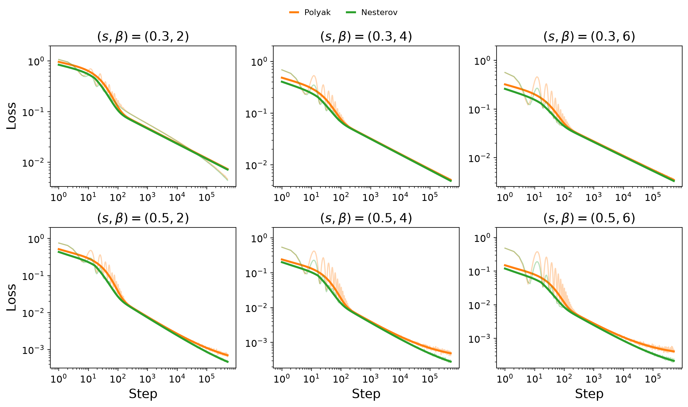
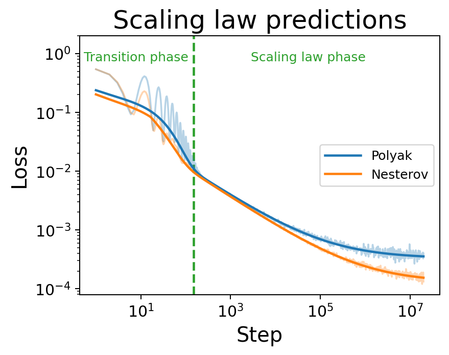
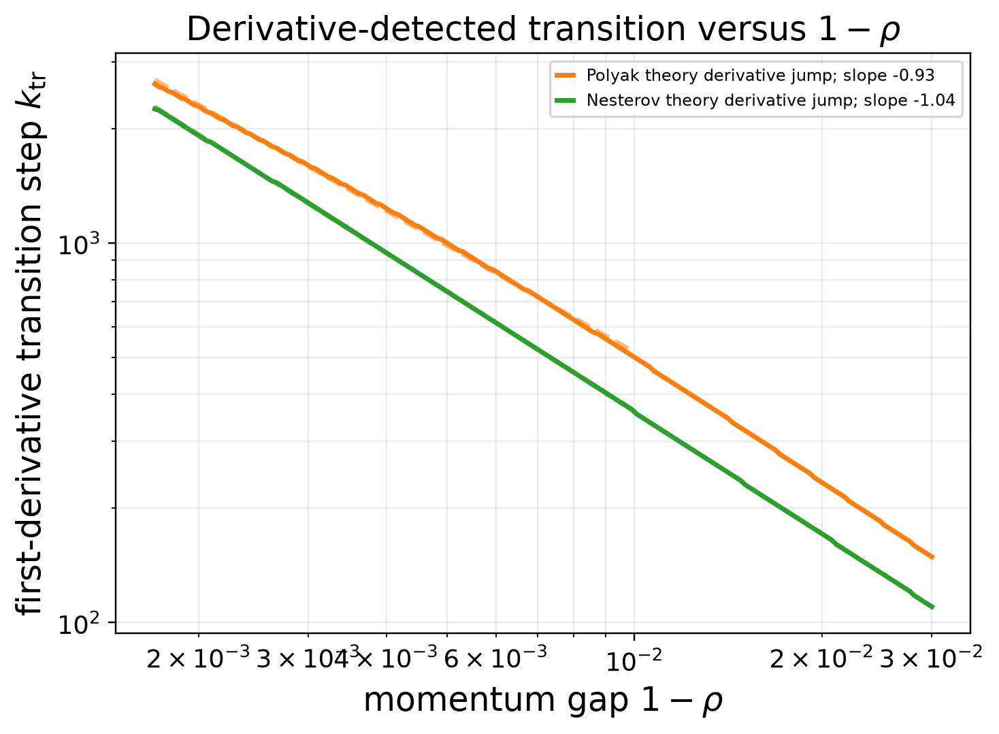

# Momentum in Large-Batch Training: Polyak Enlarges the Critical Batch Size, Nesterov Improves Data Efficiency

<p align="center">
  <a href="#introduction">📖 Introduction</a> •
  <a href="#main-results">📊 Main Results</a> •
  <a href="#experiments">🧪 Experiments</a> •
  <a href="#getting-started">🚀 Getting Started</a> •
  <a href="#citation">📚 Citation</a>
</p>

<a id="introduction"></a>

## 📖 Introduction

Momentum is a central ingredient in modern optimization, but its interaction with stochastic gradient noise and spectral structure is still not fully understood. Classical theory explains acceleration in deterministic settings, while offering a less complete picture of why Polyak and Nesterov momentum can behave differently in mini-batch training.

In this work, we study **SGD**, **Polyak heavy-ball momentum**, and **Nesterov momentum** in power-law kernel regression with Gaussian features. This model provides a tractable multi-scale learning problem in which the spectrum, target smoothness, gradient noise, and momentum dynamics can be analyzed together. The feature covariance spectrum and target obey

$$
\lambda_j \asymp j^{-\beta}, \qquad
\lambda_j |\theta_j^*|^2 \asymp j^{-(1+s\beta)},
$$

where $\beta>1$ is the capacity exponent and $s>0$ is the source exponent. Smaller $s$ places more target energy in low-curvature directions and therefore corresponds to a harder learning problem.

Our analysis connects mean-square stability with data scaling under a fixed budget $D=BK$, where $B$ is the batch size and $K$ is the number of optimization steps. It shows that Polyak momentum mainly enlarges the useful batch-size range, whereas Nesterov momentum can improve the optimal data-scaling exponent through curvature-dependent damping of stochastic noise.

This repository contains a unified PyTorch implementation of the numerical experiments. CPU, CUDA, and Apple Silicon runs share the same model and optimizer code; `--device` only selects the compute backend.

<a id="main-results"></a>

## 📊 Main Results

### 1. Stochastic Stability Boundaries

<table align="center">
  <thead>
    <tr>
      <th align="center">Method</th>
      <th align="center">Critical learning rate</th>
    </tr>
  </thead>
  <tbody>
    <tr>
      <td align="center">SGD</td>
      <td align="center">η<sup>crit</sup> ≍ 1</td>
    </tr>
    <tr>
      <td align="center">Polyak</td>
      <td align="center">η<sup>crit</sup> ≍ min{1, B(1−ρ)}</td>
    </tr>
    <tr>
      <td align="center">Nesterov</td>
      <td align="center">η<sup>crit</sup> ≍ min{1, B<sup>β</sup>(1−ρ)}</td>
    </tr>
  </tbody>
</table>

Nesterov's look-ahead correction makes its stable region grow faster with batch size, allowing it to reach the deterministic stability ceiling earlier than Polyak momentum.

### 2. Excess-Risk Scaling Laws

The expected excess risk admits a signal-learning and noise-accumulation decomposition:

$$
\mathbb{E}[\mathcal E(\theta_k)]
\asymp
\mathcal D(k)
+
\frac{\eta^2}{B}
\sum_{m=0}^{k-1}
\mathcal K(k-1-m)
(\mathbb{E}[\mathcal E(\theta_m)]+\sigma^2),
$$

where $\mathcal D(k)$ describes how the target signal is learned and $\mathcal K(\tau)$ describes how long stochastic noise remains in the dynamics. In the noisy setting, the leading long-time terms are

$$
\begin{aligned}
\text{SGD:}\qquad
\mathbb{E}[\mathcal E(\theta_k)]
&\asymp
(\eta k)^{-s}
+
\frac{\eta\sigma^2}{B},\\
\text{Polyak:}\qquad
\mathbb{E}[\mathcal E(\theta_k)]
&\asymp
(\frac{1-\rho}{\eta k})^s
+
\frac{\eta\sigma^2}{B(1-\rho)},\\
\text{Nesterov:}\qquad
\mathbb{E}[\mathcal E(\theta_k)]
&\asymp
(\frac{1-\rho}{\eta k})^s
+
\frac{\sigma^2}{B}
\min\{
\frac{\eta}{1-\rho},
(\frac{\eta}{1-\rho})^{1/\beta}
\},
\end{aligned}
$$

up to exponentially decaying transient and lower-order multiplicative-noise terms. Both momentum methods accelerate signal learning through the effective learning rate $\eta/(1-\rho)$. Polyak momentum, however, amplifies label noise by the same factor, whereas Nesterov's curvature-dependent damping clips noise accumulation in sharper spectral directions. This difference is the mechanism behind Nesterov's improved data-scaling exponent.

### 3. Data Scaling

In the presence of label noise:

- SGD achieves the optimal data-scaling rate $D^{-s/(s+1)}$.
- Polyak momentum achieves the same optimal rate but preserves it over a substantially larger range of batch sizes.
- Nesterov momentum achieves the faster rate $D^{-2s\beta/(2s\beta+\beta+1)+o(1)}$.

| Theoretical stability boundary | Data-scaling phase diagram | Critical batch size |
|---|---|---|
| <a href="assets/figures/polyak_nesterov_sgd_boundary_schematic.pdf"></a> | <a href="assets/figures/rate_diagram.pdf"></a> | <a href="assets/figures/cbs.pdf"></a> |

### Key Numerical Results

The numerical evidence is organized into four distinct experiment types:

1. **Stability** scans recover the different dependence on $B$ and $1-\rho$.
2. **Loss-dynamics** runs recover the transient-to-scaling transition and the distinct Polyak and Nesterov noise floors across six $(s,\beta)$ settings.
3. **Scaling** runs recover the predicted small-, large-, and ultra-large-batch exponents, while a fixed-$D$ sweep shows the shift in the best batch size.
4. **Blowup** runs stress-test the optimizers under an explicitly time-varying momentum schedule.

#### Scaling-law fits across six PLK settings

The $2\times3$ sweep uses $s\in\{0.3,0.5\}$ and $\beta\in\{2,4,6\}$. Pale curves show the empirical population loss and solid curves show the fitted theoretical total. The time dependence of the transient, signal, and noise terms is fixed by theory; only nonnegative $O(1)$ coefficients are fitted.

<p align="center">
  <a href="paper_artifacts/loss_dynamics/scaling_law_fits/scaling_law_fits_2x3.pdf"></a>
</p>

The fits track both the oscillatory transient and the algebraic regime. For $s=0.5$, the late-time curves also expose Nesterov's lower noise floor increasingly clearly as $\beta$ grows.

#### Time-domain transitions

| Long-time loss scaling | Transition time versus $1-\rho$ |
|---|---|
| <a href="paper_artifacts/loss_dynamics/standalone_transition_figure/total_loss_experiment_vs_theory.pdf"></a> | <a href="paper_artifacts/loss_dynamics/phase_transitions/derivative_transition_vs_one_minus_rho.pdf"></a> |

The transition from the oscillatory transient to algebraic scaling occurs at $k_{\rm tr}\propto(1-\rho)^{-1}$. Nesterov enters the scaling regime slightly earlier and reaches its lower noise-dominated regime later than Polyak.

#### Data scaling across three batch-size regimes

| Small batch | Large batch | Ultra-large batch |
|---|---|---|
| <a href="paper_artifacts/scaling/batch_regimes/s0.3beta4/small_batch.pdf"></a> | <a href="paper_artifacts/scaling/batch_regimes/s0.3beta4/large_batch.pdf"></a> | <a href="paper_artifacts/scaling/batch_regimes/s0.3beta4/super_large_batch.pdf"></a> |

For $(s,\beta)=(0.3,4)$, all three methods share the same small-batch exponent. Nesterov is fastest in the large-batch regime, while Polyak and Nesterov share the same exponent once the batch is ultra-large. In the large-batch run, the theoretical/measured exponents are $0.1772/0.1787$ for SGD, $0.2308/0.2321$ for Polyak, and $0.3039/0.3074$ for Nesterov.

#### Fixed-budget batch size and momentum schedule

| Critical batch-size sweep | Increasing-momentum diagnostic |
|---|---|
| <a href="paper_artifacts/scaling/critical_batch_size/s_0.3_beta_4/cbs.pdf"></a> | <a href="paper_artifacts/blowup/blowup_time.pdf"></a> |

At fixed $D=2^{14}$, Nesterov attains the lowest loss and shifts the best batch size upward. Under $\rho_k=1-1/(k+1)$, Polyak eventually becomes unstable, whereas Nesterov remains stable over the saved 500,000-step horizon.

<a id="experiments"></a>

## 🧪 Experiments

The repository uses four scientific categories. The category describes the
question being asked, not the optimizer or the plotting style.

| Category | What it measures | Notebook entry points | Reusable module | CLI |
|---|---|---|---|---|
| **Scaling** | Endpoint loss across data budgets or batch-size regimes | [batch regimes](experiments/scaling/batch_regimes.ipynb), [critical batch size](experiments/scaling/critical_batch_size.ipynb) | `scaling.py` | `momentum-scaling scaling` |
| **Stability** | Largest stable learning rate | [versus batch size](experiments/stability/batch_size.ipynb), [versus momentum gap](experiments/stability/momentum_gap.ipynb) | `stability.py` | `momentum-scaling stability` |
| **Loss dynamics** | Loss as a function of optimization step in stable runs | [scaling-law fits](experiments/loss_dynamics/scaling_law_fits.ipynb), [phase transitions](experiments/loss_dynamics/phase_transitions.ipynb) | `loss_dynamics.py` | `momentum-scaling loss-dynamics` |
| **Blowup** | Failure under the time-varying schedule $\rho_k=1-1/(k+1)$ | [increasing momentum](experiments/blowup/increasing_momentum.ipynb) | `blowup.py` | `momentum-scaling blowup` |

The complete experiment map is in [`experiments/README.md`](experiments/README.md).
Launch Jupyter from the repository root so every notebook writes to the ignored
`results/<category>/...` tree. Committed paper outputs are reference artifacts
under `paper_artifacts/`, not runnable code.

### 1. Scaling

Use scaling experiments when the horizontal axis is data budget $D$ or batch
size $B$ and the quantity of interest is final or tail-averaged loss.

- `batch_regimes.ipynb` compares the small-, large-, and ultra-large-batch exponents.
- `critical_batch_size.ipynb` searches for the best $B$ at fixed $D=2^{14}$.
- The CLI runs the focused Polyak and Nesterov scaling studies:

```bash
momentum-scaling scaling --preset quick --device auto --output-dir results/scaling/quick
```

### 2. Stability

Use stability experiments when the output is a largest stable learning rate.

- `batch_size.ipynb` sweeps $(B,\eta)$ at fixed $1-\rho=2^{-24}$.
- `momentum_gap.ipynb` sweeps $(1-\rho,\eta)$ at fixed $B=32$.
- The CLI provides an automation-friendly batch-size scan:

```bash
momentum-scaling stability --preset quick --device auto --output-dir results/stability/quick
```

### 3. Loss dynamics

Use loss dynamics for step-resolved curves at fixed $B$, $\eta$, and $\rho$.
These experiments fit and visualize the transient, signal-learning, and
noise-floor terms; they are not data-budget scaling experiments.

```bash
momentum-scaling loss-dynamics --preset quick --device auto \
  --output-dir results/loss_dynamics/quick
```

### 4. Blowup

Blowup is a separate diagnostic because $\rho_k$ changes during training. The
notebook and CLI compare SGD, Polyak, and Nesterov under the same increasing
momentum schedule.

```bash
momentum-scaling blowup --preset quick --device auto --output-dir results/blowup/quick
```

### Run the complete quick suite

```bash
momentum-scaling all --preset quick --device auto --output-dir results/quick
```

The `quick` preset checks wiring and device setup. Use the notebook-specific
paper configuration for quantitative claims.

<a id="getting-started"></a>

## 🚀 Getting Started

### Repository Structure

```text
.
├── experiments/                # Interactive paper experiment entry points
│   ├── scaling/
│   ├── stability/
│   ├── loss_dynamics/
│   └── blowup/
├── src/momentum_scaling/       # Reusable numerical implementation
│   ├── core.py
│   ├── scaling.py
│   ├── stability.py
│   ├── loss_dynamics.py
│   ├── blowup.py
│   ├── plotting.py
│   └── cli.py
├── paper_artifacts/            # Committed outputs from paper-scale runs
├── assets/                     # Curated figures and reference arrays
├── scripts/                    # Standalone plotting and maintenance tools
├── results/                    # New runtime outputs, excluded from Git
├── tests/
├── pyproject.toml
└── README.md
```

The data flow is one-way: notebooks and the CLI call reusable code under `src/`;
new runs write to `results/`; selected completed runs may be copied deliberately
to `paper_artifacts/`. Generated files never serve as source code.

### Installation

Python 3.10 or later is required. Creating an isolated environment is recommended:

```bash
python3 -m venv .venv
source .venv/bin/activate
python -m pip install --upgrade pip
python -m pip install -e .
```

The core package contains NumPy, PyTorch, and Matplotlib. For NVIDIA GPUs, first install the PyTorch build that matches the local CUDA version, then install this package.

Install the notebook dependencies and launch Jupyter from the repository root:

```bash
python -m pip install -e ".[notebooks]"
jupyter lab
```

Verify the installation with:

```bash
python -m unittest discover -s tests -v
momentum-scaling --help
```

### Quick Reproduction

The quick preset checks the environment, device selection, and complete CLI experiment pipeline. It normally finishes quickly, but it is **not a quantitative replacement for the paper configuration**.

```bash
momentum-scaling all --preset quick --device auto --output-dir results/quick
```

The two focused scaling experiments can be run independently:

```bash
momentum-scaling polyak-scaling --preset quick --device auto --output-dir results/polyak
momentum-scaling nesterov-scaling --preset quick --device auto --output-dir results/nesterov
```

The experiments can also be run without installing the command-line entry point:

```bash
PYTHONPATH=src python -m momentum_scaling.cli all \
  --preset quick --device auto --output-dir results/quick
```

The generated files are:

```text
results/quick/
├── stability.{json,npz,png,pdf}
├── polyak_scaling.{json,png,pdf}
├── nesterov_scaling.{json,png,pdf}
├── loss_dynamics.{json,png,pdf}
├── loss_dynamics_polyak.npz
├── loss_dynamics_nesterov.npz
└── blowup.{json,npz,png,pdf}
```

The JSON files record the configuration, device, random seed, schedules, means, standard deviations, and fitted exponents or scaling-law coefficients. The NPZ files store dense numerical arrays such as stability grids, per-seed boundaries, and long-time loss curves.

The original grids for eight stability settings are preserved under
`assets/results/stability_beta*_s*_reference.npz`. The plotting script keeps the
original green/blue/orange algorithm colors, removes the background region fills,
and includes prediction lines for SGD, Polyak, and Nesterov. To keep the legend
compact, empirical markers are unlabeled and only the three prediction curves
appear in the legend.

Recreate one setting or all eight settings with:

```bash
python scripts/plot_stability_reference.py --beta 1.5 --s 2
python scripts/plot_stability_reference.py --all
```

The available settings are $(\beta,s)=(1.5,2),(1.5,3),(1.5,5),(2,2),(2,3),
(2,5),(2.5,3),(2.5,5)$. Generated PNG and PDF files are stored under
`assets/figures/` using names such as `beta1_5s3_plot.png` and
`beta1_5s3_plot.pdf`.

### CPU, CUDA, and Apple Silicon

```bash
# Automatic selection: CUDA, then MPS, then CPU
momentum-scaling all --preset quick --device auto

# Force CPU execution
momentum-scaling all --preset quick --device cpu --dtype float64

# Select an NVIDIA GPU
momentum-scaling all --preset quick --device cuda:0 --dtype float64

# Apple Silicon
momentum-scaling all --preset quick --device mps --dtype float32
```

MPS has limited support for `float64`. Therefore, `--dtype auto` selects `float32` on MPS and `float64` on CPU and CUDA. The paper-scale stability scan should be run on a CPU or CUDA GPU with double-precision support.

### Reproducibility Notes

- All random numbers are controlled by `--seed`.
- Deterministic seed offsets are assigned to algorithms, experiment points, and independent repetitions.
- CPU and GPU runs share the same mathematical implementation, although small floating-point differences may remain across hardware, BLAS, and CUDA versions.
- The stability experiment uses fresh Gaussian mini-batches and computes gradients in chunks to limit memory use.
- Following the paper appendix, the data-scaling experiment directly samples curvature-aligned Gaussian gradient noise.
- Each run prints the Python version, PyTorch version, device, and dtype. The same information is stored in the result JSON files.
- The `quick` preset is intended only as a smoke test. Paper-level conclusions should use the `paper` preset and 100 repetitions where specified.

<a id="citation"></a>

## 📚 Citation

If you use this code or build on these experiments, please cite:

```bibtex
@misc{wang2026momentumlargebatch,
  title = {Momentum in Large-Batch Training: Polyak Enlarges the Critical Batch Size, Nesterov Improves Data Efficiency},
  author = {Wang, Jia-Nan and Huang, Zixun and Li, Kairui and Wu, Lei},
  year = {2026},
  note = {Manuscript}
}
```
