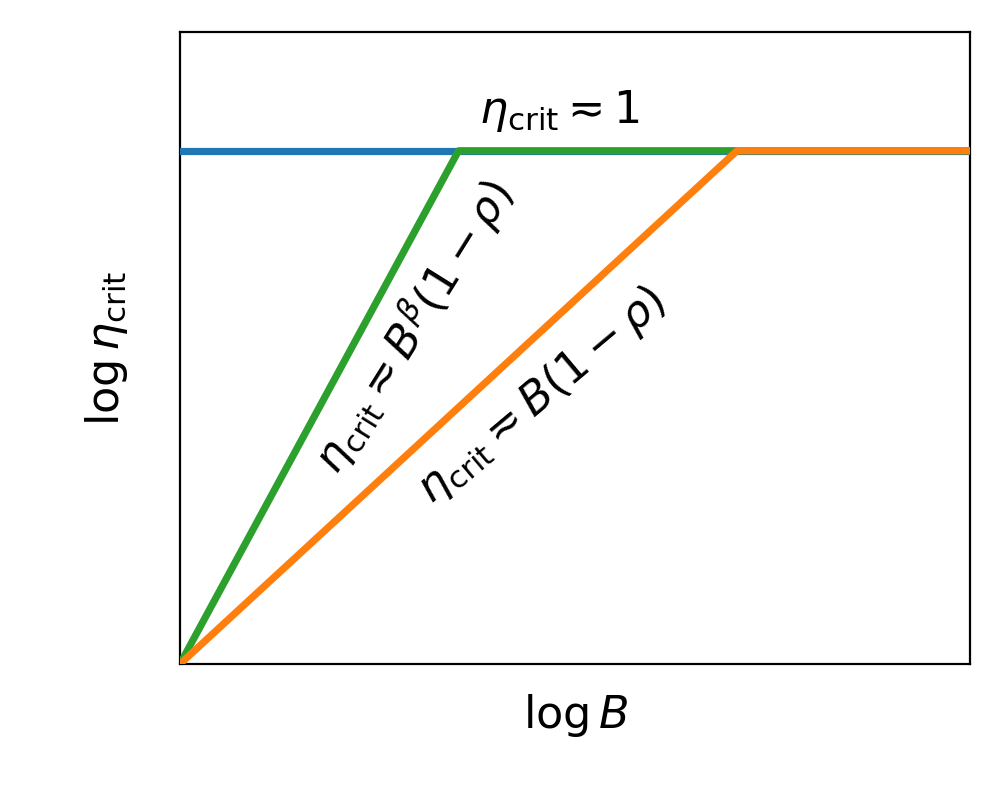

# Momentum in Large-Batch Training

This repository contains the experiments for **SGD**, **Polyak momentum**, and
**Nesterov momentum** in power-law kernel regression. It is organized for a
reader, not around implementation layers: the repository has exactly four
experiment folders, and each folder contains its notebooks, Python code,
explanation, and saved results.

The model uses

$$
\lambda_j \asymp j^{-\beta}, \qquad
\lambda_j |\theta_j^*|^2 \asymp j^{-(1+s\beta)}.
$$

## Experiments and results

| Folder | Question | Start here | Main saved result |
|---|---|---|---|
| [`data_scaling/`](data_scaling/) | How does final loss scale with data budget and batch size? | [`batch_regimes.ipynb`](data_scaling/batch_regimes.ipynb), [`critical_batch_size.ipynb`](data_scaling/critical_batch_size.ipynb) | Nesterov has the fastest large-batch exponent and the lowest fixed-budget loss. |
| [`loss/`](loss/) | How does loss evolve over optimization time? | [`scaling_law_fits.ipynb`](loss/scaling_law_fits.ipynb), [`phase_transitions.ipynb`](loss/phase_transitions.ipynb) | The fits recover transient, algebraic, and noise-floor regimes; Nesterov has the lower noise floor. |
| [`blowup/`](blowup/) | What happens under increasing momentum? | [`increasing_momentum.ipynb`](blowup/increasing_momentum.ipynb) | Polyak eventually diverges while Nesterov remains stable over the saved horizon. |
| [`stability/`](stability/) | Which learning rates remain stable? | [`batch_size.ipynb`](stability/batch_size.ipynb), [`momentum_gap.ipynb`](stability/momentum_gap.ipynb) | The aligned scans test the two normalized stability laws with a shared cross-point. |

| Data scaling | Blowup | Stability |
|---|---|---|
| <a href="data_scaling/results/batch_regimes/s0.3beta4/large_batch.pdf"></a> | <a href="blowup/results/blowup_time.pdf"></a> | <a href="stability/results/batch_size_schematic/stability_boundary.pdf"></a> |

### Data scaling

For $(s,\beta)=(0.3,4)$, all three methods share the small-batch exponent.
Nesterov is fastest in the large-batch regime. The theoretical/measured
large-batch exponents are $0.1772/0.1787$ for SGD, $0.2308/0.2321$ for Polyak,
and $0.3039/0.3074$ for Nesterov. At fixed $D=2^{14}$, Nesterov reaches the
lowest loss and shifts the best batch size upward.

### Loss

The six-setting sweep uses $s\in\{0.3,0.5\}$ and
$\beta\in\{2,4,6\}$. The fitted curves track both the oscillatory transient and
the algebraic regime. The transition time follows
$k_{\rm tr}\propto(1-\rho)^{-1}$, and Nesterov reaches a lower late-time noise
floor.

### Blowup

Under the schedule $\rho_k=1-1/(k+1)$, Polyak eventually becomes unstable,
whereas Nesterov remains stable over the saved 500,000-step horizon.

### Stability

The stability scans recover

$$
\eta^{\rm crit}_{\rm Polyak}\asymp\min\{1,B(1-\rho)\}, \qquad
\eta^{\rm crit}_{\rm Nesterov}\asymp\min\{1,B^\beta(1-\rho)\}.
$$

The two runnable stability notebooks use identical settings and intersect at
$(B,1-\rho)=(16,2^{-8})$. They fit the same normalized coefficient against
$B(1-\rho)$ for Polyak and $B^\beta(1-\rho)$ for Nesterov. Existing committed
stability figures are older reference outputs; rerun both notebooks for the
aligned comparison.

## Folder layout

```text
.
├── data_scaling/   # notebooks, code, plotting tools, saved results
├── loss/           # notebooks, code, saved results
├── blowup/         # notebook, code, saved results
├── stability/      # notebooks, code, plotting tools, saved results
├── README.md
├── requirements.txt
└── pyproject.toml
```

Inside each experiment folder:

- `README.md` explains the scientific question and the files to read;
- `*.ipynb` files are the paper experiment entry points;
- `experiment.py` contains the reusable experiment implementation;
- `core.py` keeps that folder self-contained;
- `results/` contains committed paper-scale outputs;
- `results/generated/` is reserved for new runs and ignored by Git.

The repeated `core.py` is intentional: a reader can copy or inspect any one
experiment folder without tracing imports through another directory.

## Running the notebooks

Python 3.10 or later is required.

```bash
python3 -m venv .venv
source .venv/bin/activate
python -m pip install -r requirements.txt
jupyter lab
```

Launch Jupyter from the repository root and open one of the notebooks in the
four folders. Each notebook writes generated files only inside its own folder.
Set `PAPER_RUN=True` where available to use the paper-scale configuration; the
default quick configuration is intended for checking the environment and code
path.

## Reproducibility

- CPU, CUDA, and Apple Silicon use the same PyTorch update rules.
- Random seeds are explicit and deterministic.
- Saved numerical arrays (`.npz`, `.json`, and `.csv`) live beside the figures
  that use them.
- PNG files provide quick previews; PDF files are the publication-quality
  versions.

## Citation

```bibtex
@misc{wang2026momentumlargebatch,
  title = {Momentum in Large-Batch Training: Polyak Enlarges the Critical Batch Size, Nesterov Improves Data Efficiency},
  author = {Wang, Jia-Nan and Huang, Zixun and Li, Kairui and Wu, Lei},
  year = {2026},
  note = {Manuscript}
}
```
