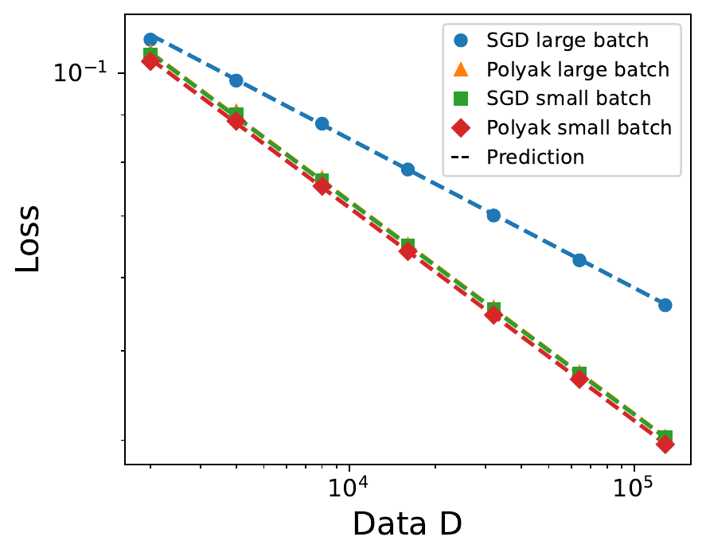
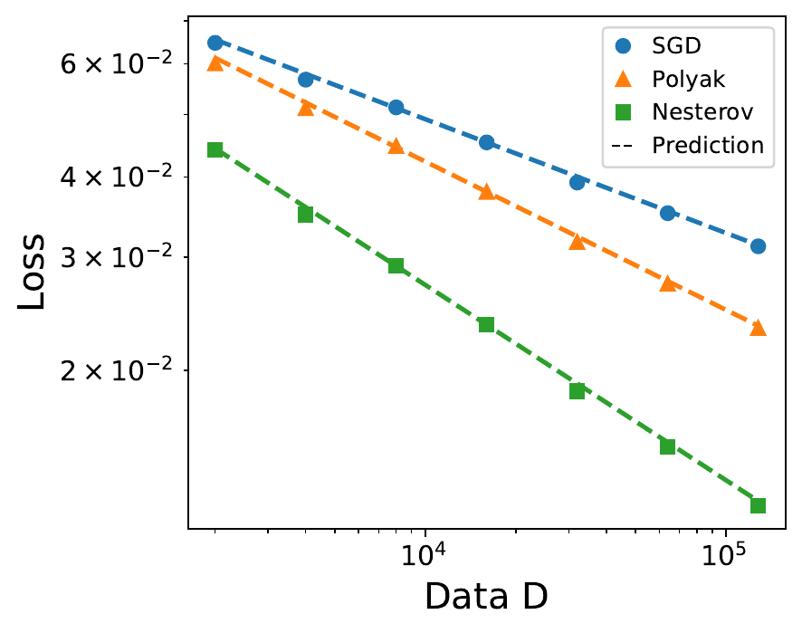

# From Polyak to Nesterov: Momentum Scaling in Power-Law Kernel Regression

This repository provides a streamlined implementation for reproducing the experiments in **“From Polyak to Nesterov: Landscape-Aware Momentum Methods May Improve Stability and Data Scaling.”** It studies stochastic optimization in high-dimensional power-law kernel regression and compares **SGD**, **Polyak heavy-ball momentum**, and **Nesterov momentum** in terms of stability, critical batch size, and data-scaling behavior.

> The former duplicated CPU and GPU notebooks have been replaced by a single PyTorch implementation. The `--device` option only changes the compute device; the model, random process, optimizer updates, and experiment configurations all share the same code.

## Main Results

The feature covariance spectrum and target satisfy

\[
\lambda_j \asymp j^{-\beta}, \qquad
\lambda_j |\theta_j^\star|^2 \asymp j^{-(1+s\beta)},
\]

where \(\beta>1\) is the capacity exponent and \(s>0\) is the source exponent. The data budget is \(D=BK\), where \(B\) is the batch size and \(K\) is the number of optimization steps.

### 1. Stochastic Stability Boundaries

| Method | Critical learning rate |
|---|---|
| SGD | \(\eta_{\mathrm{stab}}\asymp 1\) |
| Polyak | \(\eta_{\mathrm{stab}}\asymp \min\{1,B(1-\rho)\}\) |
| Nesterov | \(\eta_{\mathrm{stab}}\asymp \min\{1,B^\beta(1-\rho)\}\) |

Nesterov's look-ahead correction makes its stable region grow faster with batch size, allowing it to reach the deterministic stability ceiling earlier than Polyak momentum.

### 2. Data Scaling

In the presence of label noise:

- SGD achieves the optimal data-scaling rate \(D^{-s/(s+1)}\).
- Polyak momentum achieves the same optimal rate but preserves it over a substantially larger range of batch sizes.
- Nesterov momentum achieves the faster rate
  \[
  D^{-\frac{2s\beta}{2s\beta+\beta+1}+o(1)}.
  \]


## Key Numerical Results from the Paper

The left panel validates the distinct stability boundaries of Polyak and Nesterov momentum. The middle panel shows that Polyak momentum preserves the optimal scaling rate beyond SGD's critical batch size. The right panel shows that Nesterov momentum achieves a faster data-scaling rate in the large-batch regime.

| Stability boundary | Polyak critical batch size | Nesterov large-batch acceleration |
|---|---|---|
|  |  |  |

## Repository Structure

```text
.
├── README.md
├── pyproject.toml              # Editable installation and CLI entry point
├── requirements.txt
├── src/momentum_scaling/
│   ├── core.py                 # Power-law problem, shared backend, and optimizers
│   ├── experiments.py          # Stability and data-scaling experiments
│   ├── plotting.py             # Generates figures from saved results
│   └── cli.py                  # Unified command-line interface
├── tests/test_core.py          # Tests for the model and update equations
├── paper/                      # LaTeX source, bibliography, and original figures
├── assets/figures/             # Key PNG figures displayed in this README
└── results/                    # Runtime outputs, excluded from version control
```

The old CPU/GPU notebooks, duplicated plotting scripts, caches, temporary binaries, and redundant PDF files have been removed. The paper source is retained under `paper/` for direct comparison with the theorems, experimental configurations, and original figures.

## Installation

Python 3.10 or later is required. Creating an isolated environment is recommended:

```bash
python3 -m venv .venv
source .venv/bin/activate
python -m pip install --upgrade pip
python -m pip install -e .
```

`requirements.txt` contains only NumPy, PyTorch, and Matplotlib. For NVIDIA GPUs, first install the PyTorch build that matches the local CUDA version, then run `python -m pip install -e .`.

Verify the installation with:

```bash
python -m unittest discover -s tests -v
momentum-scaling --help
```

## Quick Reproduction

The quick preset checks the environment, device selection, and complete experiment pipeline. It normally finishes quickly, but it is **not a quantitative replacement for the paper configuration**.

```bash
momentum-scaling all --preset quick --device auto --output-dir results/quick
```

The experiments can also be run without installing the command-line entry point:

```bash
PYTHONPATH=src python -m momentum_scaling.cli all \
  --preset quick --device auto --output-dir results/quick
```

The generated files are:

```text
results/quick/
├── stability.json
├── stability.npz
├── stability.png
├── stability.pdf
├── data_scaling.json
├── data_scaling.png
└── data_scaling.pdf
```

The JSON files record the configuration, device, random seed, means, and standard deviations for every experiment point. The NPZ file additionally stores the complete stability grid and per-seed stability boundaries for further inspection.

## Paper-Scale Reproduction

### Stability Boundaries

The paper configuration uses \(d=4096\), \(1-\rho=2^{-24}\), \(B=2^0,\ldots,2^{12}\), 50 learning rates, 2,000 optimization steps, and five random seeds.

```bash
momentum-scaling stability \
  --preset paper \
  --device cuda \
  --dtype float64 \
  --seed 0 \
  --output-dir results/stability
```

Because \(1-\rho\) is extremely small, `float64` is recommended. With `float32`, \(\rho\) may be rounded to 1. This scan is computationally expensive and is best run on a CUDA GPU.

### Data-Scaling Experiments

The paper configuration uses \(d=4096\), \(s=0.3\), \(\beta=4\), \(\sigma=0.1\), and
\(D\in\{2000,4000,8000,16000,32000,64000,128000\}\), with 100 independent repetitions per point.

```bash
momentum-scaling data-scaling \
  --preset paper \
  --device cuda \
  --dtype float64 \
  --seed 0 \
  --output-dir results/data_scaling
```

This command runs both data-scaling experiments described in the paper appendix:

1. **Polyak critical-batch experiment:** compares \(B\asymp D^{s/(s+1)}\) with \(B\asymp D^{2s/(s+1)}\).
2. **Nesterov large-batch experiment:** uses the theoretically prescribed Nesterov batch-size scaling for all methods and averages the excess risk over the final 1% of optimization steps.

To regenerate figures from existing result files without rerunning the experiments:

```bash
momentum-scaling plot --output-dir results/data_scaling
```

## CPU, CUDA, and Apple Silicon

```bash
# Automatic selection: CUDA, then MPS, then CPU
momentum-scaling all --preset quick --device auto

# Force CPU execution
momentum-scaling all --preset quick --device cpu --dtype float64

# Select an NVIDIA GPU
momentum-scaling all --preset quick --device cuda:0 --dtype float64

# Apple Silicon
momentum-scaling all --preset quick --device mps --dtype float32
```

MPS has limited support for `float64`. Therefore, `--dtype auto` selects `float32` on MPS and `float64` on CPU and CUDA. The paper-scale stability scan should be run on a CPU or CUDA GPU with double-precision support.

## Reproducibility Notes

- All random numbers are controlled by `--seed`.
- Deterministic seed offsets are assigned to algorithms, experiment points, and independent repetitions.
- CPU and GPU runs share the same mathematical implementation, although small floating-point differences may remain across hardware, BLAS, and CUDA versions.
- The stability experiment uses fresh Gaussian mini-batches and computes gradients in chunks to limit memory use.
- Following the paper appendix, the data-scaling experiment directly samples curvature-aligned Gaussian gradient noise.
- Each run prints the Python version, PyTorch version, device, and dtype. The same information is stored in the result JSON files.
- The `quick` preset is intended only as a smoke test. Paper-level conclusions should use the `paper` preset and 100 repetitions where specified.

## Optimizer Conventions

This repository follows the update equations used in the paper:

\[
\begin{aligned}
\text{SGD: }&\theta_{k+1}=\theta_k-\eta\widehat g_k(\theta_k),\\
\text{Polyak: }&\theta_{k+1}=\theta_k-\eta\widehat g_k(\theta_k)
+\rho(\theta_k-\theta_{k-1}),\\
\text{Nesterov: }&\widetilde\theta_k=\theta_k+\rho(\theta_k-\theta_{k-1}),\\
&\theta_{k+1}=\widetilde\theta_k-\eta\widehat g_k(\widetilde\theta_k).
\end{aligned}
\]

These conventions are not always identical to Nesterov implementations in deep-learning frameworks that use different learning-rate parameterizations. The repository therefore does not call a built-in framework optimizer.

## Paper Source

The main paper is located at `paper/main_arxiv.tex`. Experimental details are provided in the **Experimental Details** section of `paper/appendix.tex`.

Compilation depends on the local TeX installation. A typical command is:

```bash
cd paper
latexmk -pdf main_arxiv.tex
```
