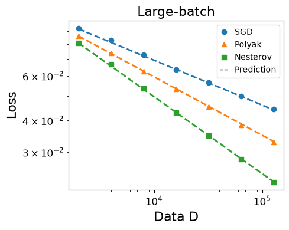
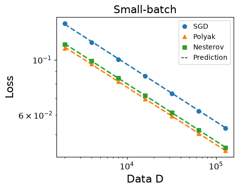
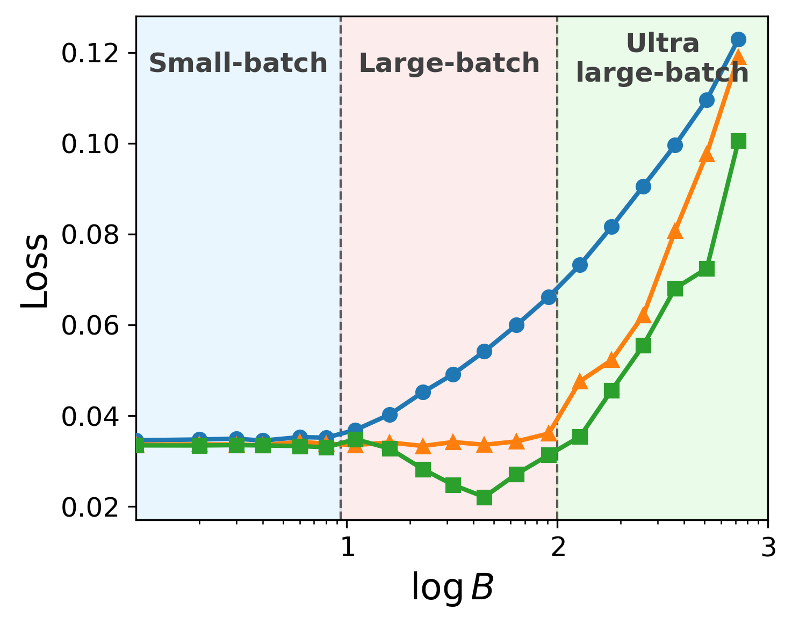
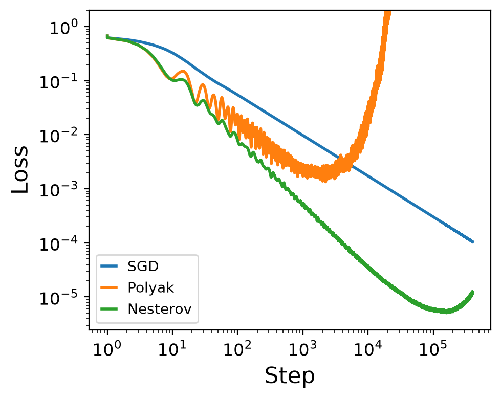

# Momentum in Large-Batch Training: Polyak Enlarges the Critical Batch Size, Nesterov Improves Data Efficiency

<p align="center">
  <a href="#introduction">📖 Introduction</a> •
  <a href="#main-results">📊 Main Results</a> •
  <a href="#experiments">🧪 Experiments</a> •
  <a href="#additional-experiments">🔬 Paper-Scale Results</a> •
  <a href="#getting-started">🚀 Getting Started</a> •
  <a href="#citation">📚 Citation</a>
</p>

<a id="introduction"></a>

## 📖 Introduction

Momentum is a central ingredient in modern optimization, but its interaction with stochastic gradient noise and spectral structure is still not fully understood. Classical theory explains acceleration in deterministic settings, while offering a less complete picture of why Polyak and Nesterov momentum can behave differently in mini-batch training.

In this work, we study **SGD**, **Polyak heavy-ball momentum**, and **Nesterov momentum** in power-law kernel regression with Gaussian features. This model provides a tractable multi-scale learning problem in which the spectrum, target smoothness, gradient noise, and momentum dynamics can be analyzed together. The feature covariance spectrum and target obey

$$
\lambda_j \asymp j^{-\beta}, \qquad
\lambda_j |\theta_j^*|^2 \asymp j^{-(1+s\beta)},
$$

where $\beta>1$ is the capacity exponent and $s>0$ is the source exponent. Smaller $s$ places more target energy in low-curvature directions and therefore corresponds to a harder learning problem.

Our analysis connects mean-square stability with data scaling under a fixed budget $D=BK$, where $B$ is the batch size and $K$ is the number of optimization steps. It shows that Polyak momentum mainly enlarges the useful batch-size range, whereas Nesterov momentum can improve the optimal data-scaling exponent through curvature-dependent damping of stochastic noise.

This repository contains a unified PyTorch implementation of the numerical experiments. CPU, CUDA, and Apple Silicon runs share the same model and optimizer code; `--device` only selects the compute backend.

<a id="main-results"></a>

## 📊 Main Results

### 1. Stochastic Stability Boundaries

<table align="center">
  <thead>
    <tr>
      <th align="center">Method</th>
      <th align="center">Critical learning rate</th>
    </tr>
  </thead>
  <tbody>
    <tr>
      <td align="center">SGD</td>
      <td align="center">η<sup>crit</sup> ≍ 1</td>
    </tr>
    <tr>
      <td align="center">Polyak</td>
      <td align="center">η<sup>crit</sup> ≍ min{1, B(1−ρ)}</td>
    </tr>
    <tr>
      <td align="center">Nesterov</td>
      <td align="center">η<sup>crit</sup> ≍ min{1, B<sup>β</sup>(1−ρ)}</td>
    </tr>
  </tbody>
</table>

Nesterov's look-ahead correction makes its stable region grow faster with batch size, allowing it to reach the deterministic stability ceiling earlier than Polyak momentum.

### 2. Excess-Risk Scaling Laws

The expected excess risk admits a signal-learning and noise-accumulation decomposition:

$$
\mathbb{E}[\mathcal E(\theta_k)]
\asymp
\mathcal D(k)
+
\frac{\eta^2}{B}
\sum_{m=0}^{k-1}
\mathcal K(k-1-m)
(\mathbb{E}[\mathcal E(\theta_m)]+\sigma^2),
$$

where $\mathcal D(k)$ describes how the target signal is learned and $\mathcal K(\tau)$ describes how long stochastic noise remains in the dynamics. In the noisy setting, the leading long-time terms are

$$
\begin{aligned}
\text{SGD:}\qquad
\mathbb{E}[\mathcal E(\theta_k)]
&\asymp
(\eta k)^{-s}
+
\frac{\eta\sigma^2}{B},\\
\text{Polyak:}\qquad
\mathbb{E}[\mathcal E(\theta_k)]
&\asymp
(\frac{1-\rho}{\eta k})^s
+
\frac{\eta\sigma^2}{B(1-\rho)},\\
\text{Nesterov:}\qquad
\mathbb{E}[\mathcal E(\theta_k)]
&\asymp
(\frac{1-\rho}{\eta k})^s
+
\frac{\sigma^2}{B}
\min\{
\frac{\eta}{1-\rho},
(\frac{\eta}{1-\rho})^{1/\beta}
\},
\end{aligned}
$$

up to exponentially decaying transient and lower-order multiplicative-noise terms. Both momentum methods accelerate signal learning through the effective learning rate $\eta/(1-\rho)$. Polyak momentum, however, amplifies label noise by the same factor, whereas Nesterov's curvature-dependent damping clips noise accumulation in sharper spectral directions. This difference is the mechanism behind Nesterov's improved data-scaling exponent.

### 3. Data Scaling

In the presence of label noise:

- SGD achieves the optimal data-scaling rate $D^{-s/(s+1)}$.
- Polyak momentum achieves the same optimal rate but preserves it over a substantially larger range of batch sizes.
- Nesterov momentum achieves the faster rate $D^{-2s\beta/(2s\beta+\beta+1)+o(1)}$.

| Theoretical stability boundary | Data-scaling phase diagram | Critical batch size |
|---|---|---|
| <a href="assets/figures/polyak_nesterov_sgd_boundary_schematic.pdf"></a> | <a href="assets/figures/rate_diagram.pdf"></a> | <a href="assets/figures/cbs.pdf"></a> |

### Key Numerical Results

The numerical evidence follows the theory in three steps:

1. Stability scans recover the different dependence on $B$ and $1-\rho$.
2. Long-time runs recover the transient-to-scaling transition and the distinct Polyak and Nesterov noise floors across six $(s,\beta)$ settings.
3. Data-budget runs recover the predicted small-, large-, and ultra-large-batch exponents, while a fixed-$D$ sweep shows the shift in the best batch size.

#### Scaling-law fits across six PLK settings

The $2\times3$ sweep uses $s\in\{0.3,0.5\}$ and $\beta\in\{2,4,6\}$. Pale curves show the empirical population loss and solid curves show the fitted theoretical total. The time dependence of the transient, signal, and noise terms is fixed by theory; only nonnegative $O(1)$ coefficients are fitted.

<p align="center">
  <a href="new_scaling/scaling%20law/scaling_law/scaling_law_fits_2x3.pdf"></a>
</p>

The fits track both the oscillatory transient and the algebraic regime. For $s=0.5$, the late-time curves also expose Nesterov's lower noise floor increasingly clearly as $\beta$ grows.

#### Representative long-time and data-scaling results

| Long-time loss scaling | Large-batch data scaling |
|---|---|
| <a href="new_scaling/scaling%20law/new/total_loss_experiment_vs_theory.pdf"></a> | <a href="new_scaling/nag_acc_three_phases/s0.3beta4/large_batch.pdf"></a> |

In the representative large-batch run at $(s,\beta)=(0.3,4)$, the theoretical/measured decay exponents are $0.1772/0.1787$ for SGD, $0.2308/0.2321$ for Polyak, and $0.3039/0.3074$ for Nesterov. The full small-, large-, and ultra-large-batch comparison is summarized below.

<a id="experiments"></a>

## 🧪 Experiments

The maintained command-line interface is organized around the three core experimental components of the project. Each component has its own source file and a directly runnable CLI entry point. The full research sweeps and their saved outputs are catalogued separately in [Paper-Scale Experiments and Saved Results](#additional-experiments).

| Experiment | Source file | CLI command | Main outputs |
|---|---|---|---|
| Stability | `src/momentum_scaling/stability.py` | `momentum-scaling stability` | `stability.json`, `stability.npz`, `stability.png`, `stability.pdf` |
| Scaling law | `src/momentum_scaling/scaling_law.py` | `momentum-scaling scaling-law` | `scaling_law.json`, `scaling_law_polyak.npz`, `scaling_law_nesterov.npz`, `scaling_law.png`, `scaling_law.pdf` |
| Data scaling | `src/momentum_scaling/data_scaling.py` | `momentum-scaling data-scaling` | `polyak_scaling.json/png/pdf`, `nesterov_scaling.json/png/pdf` |

Shared model construction, optimizers, device selection, and stochastic-gradient utilities live in `src/momentum_scaling/core.py`. Plotting is kept separate in `src/momentum_scaling/plotting.py`, and `src/momentum_scaling/cli.py` only dispatches commands.

### 1. Stability experiment

This experiment scans the largest stable learning rate as a function of batch size. It uses fresh Gaussian mini-batches and compares SGD, Polyak momentum, and Nesterov momentum.

```bash
momentum-scaling stability --preset quick --device auto --output-dir results/stability
```

Use `--preset paper` for the larger configuration used to produce paper-quality stability boundaries.

### 2. Scaling-law experiment

This experiment fixes `B`, `eta`, and `rho`, then runs Polyak and Nesterov for many optimization steps. It checks the long-time loss curve against the scaling-law decomposition into transient, signal-learning, and noise-floor terms.

```bash
momentum-scaling scaling-law --preset quick --device auto --output-dir results/scaling_law
```

For $\eta_\rho=\eta/(1-\rho)$, the fitted prediction curves use

$$
L_{\rm Polyak}(k)
\approx
C_T\rho^k
+C_S(\eta_\rho k)^{-s}
+C_N\frac{\sigma^2}{B}\eta_\rho,
$$

and

$$
L_{\rm Nesterov}(k)
\approx
C_T
\left(\frac{(1-\rho)^2}{\eta}\right)^{s+1/\beta}
\left(\frac{4\rho^2}{(1+\rho)^2}\right)^k
+C_S(\eta_\rho k)^{-s}
+C_N\frac{\sigma^2}{B}\min\{\eta_\rho,\eta_\rho^{1/\beta}\}.
$$

The constants $C_T,C_S,C_N\ge0$ are fitted only to restore unspecified $O(1)$ factors in the asymptotic theory. The six-setting paper-scale sweep is in `new_scaling/scaling law/scaling_law_fitting_experiments.ipynb`; the transition analysis and long-time figure are in `new_scaling/scaling law/momentum_three_phase_transitions.ipynb`.

### 3. Data-scaling experiment

This experiment varies the total data budget $D=BK$ and measures how the final excess risk decays with $D$. It contains the focused Polyak batch-scaling study and the shared Nesterov-optimal large-batch study.

```bash
momentum-scaling data-scaling --preset quick --device auto --output-dir results/data_scaling
```

The two data-scaling sub-experiments can also be run independently:

```bash
momentum-scaling polyak-scaling --preset quick --device auto --output-dir results/polyak
momentum-scaling nesterov-scaling --preset quick --device auto --output-dir results/nesterov
```

### Run all three

```bash
momentum-scaling all --preset quick --device auto --output-dir results/quick
```

The `quick` preset is a smoke test for correctness and device setup. For quantitative claims, use the `paper` preset and enough repetitions for the relevant experiment.

<a id="additional-experiments"></a>

## 🔬 Paper-Scale Experiments and Saved Results

The `new_scaling/` archive contains the full research sweeps behind the main numerical claims. The summary below is read from saved JSON, CSV, NPZ, notebook outputs, and figures; the runs do not need to be repeated to inspect the reported results.

### Experiment map

| Question | Experiment | Saved result |
|---|---|---|
| How does stability change with the momentum gap $1-\rho$ at fixed batch size? | `new_scaling/new_stability.ipynb` | [`new_stability_summary.json`](new_scaling/new_stability_summary.json), [`new_stability.pdf`](new_scaling/new_stability.pdf) |
| Do the Polyak and Nesterov scaling laws fit across different source/capacity exponents? | `new_scaling/scaling law/scaling_law_fitting_experiments.ipynb` | [`scaling_law_fits_2x3.pdf`](new_scaling/scaling%20law/scaling_law/scaling_law_fits_2x3.pdf) and six per-setting NPZ files |
| Where are the transient-to-scaling and scaling-to-noise transitions? | `new_scaling/scaling law/momentum_three_phase_transitions.ipynb` | [`total_loss_experiment_vs_theory.pdf`](new_scaling/scaling%20law/new/total_loss_experiment_vs_theory.pdf), [`derivative_transition_vs_one_minus_rho.pdf`](new_scaling/scaling%20law/results/new_scaling/derivative_transition_vs_one_minus_rho.pdf) |
| How do data-scaling rates change across small, large, and ultra-large batches? | `new_scaling/nag_acc_three_phases.ipynb` | `new_scaling/nag_acc_three_phases/s*/{small,large,super_large}_batch.{png,pdf}` |
| Where is the best batch size under a fixed data budget? | `new_scaling/cbs.ipynb`, `new_scaling/cbs.py` | `new_scaling/cbs/s_*_beta_*/optimal_loss.csv` and `cbs.{png,pdf}` |
| What happens under an increasingly aggressive momentum schedule? | `new_scaling/blow_up.py` | [`blowup_time.pdf`](new_scaling/blowup/blowup_time.pdf) |

### 1. Stability versus the momentum gap

This experiment fixes $B$ and scans $g=1-\rho$. The saved paper-run cache uses $(\beta,s)=(1.5,0.3)$, $B=16$, dimension 4096, no label noise, 2000 steps, and five seeds. Polyak and Nesterov are fit to

$$
\eta^{\rm crit}=\min\{L,c(1-\rho)\},
$$

while SGD is fit to a constant level.

| Method | Rising coefficient $c$ | Momentum-gap breakpoint | Stability ceiling $L$ |
|---|---:|---:|---:|
| SGD | — | — | 1.4809 |
| Polyak | 11.0724 | 0.05506 | 0.6096 |
| Nesterov | 53.6998 | 0.01447 | 0.7771 |

Both momentum boundaries have the predicted unit log-log slope before saturation. Nesterov's fitted rising coefficient is $4.85\times$ Polyak's and it reaches its ceiling at a $3.80\times$ smaller momentum gap, consistent with the stronger $B^\beta(1-\rho)$ stability scaling.

The notebook is cache-aware: its editable defaults currently show $(\beta,s,B)=(2,3,32)$, but the saved summary and PDF above describe the embedded cache configuration reported in this table.

### 2. Scaling-law fits across six PLK settings

The $2\times3$ sweep uses $s\in\{0.3,0.5\}$ and $\beta\in\{2,4,6\}$ with $B=64$, $\eta=0.06$, $1-\rho=0.03$, $\sigma=0.2$, dimension 4096, 100 replicas, and 500,000 steps. It fits nonnegative coefficients to the theoretical term shapes while leaving their time dependence fixed.

The combined figure is shown in [Key Numerical Results](#key-numerical-results), and the archive also includes a PNG, PDF, and NPZ file for each setting. Across all six settings, the fitted totals track the empirical curves through the oscillatory transient and the algebraic scaling regime. The lower Nesterov noise floor is most visible for $s=0.5$ and larger $\beta$, matching the predicted clipping term $\min\{\eta_\rho,\eta_\rho^{1/\beta}\}$.

### 3. Three time-domain phases

The long run at $(s,\beta)=(0.5,4)$ uses $B=64$, $\eta=0.06$, $1-\rho=0.03$, $\sigma=0.2$, 100 replicas, and 20 million steps. The first transition is detected from the strongest early change in $d\log\widehat L/d\log k$; the second is the point where the fitted noise floor reaches 70% of the fitted late-time total.

| Method | Phase $1\to2$ step | Phase $2\to3$ step | Small-gap slope of $k_{\rm tr}$ vs. $1-\rho$ |
|---|---:|---:|---:|
| Polyak | 149 | $6.77\times10^5$ | -0.932 |
| Nesterov | 110 | $4.19\times10^6$ | -1.040 |

The slopes are close to $-1$, so the first transition scales approximately as $k_{\rm tr}\propto(1-\rho)^{-1}$. Nesterov enters the scaling regime slightly earlier but reaches its lower noise-dominated regime much later.

The representative total-loss curve is shown in [Key Numerical Results](#key-numerical-results). The momentum-gap sweep below verifies the transition-time dependence.

<p align="center">
  <a href="new_scaling/scaling%20law/results/new_scaling/derivative_transition_vs_one_minus_rho.pdf"></a>
</p>

### 4. Data scaling in three batch-size regimes

The representative saved run uses $(s,\beta)=(0.3,4)$ and $D\in\{2000,4000,\ldots,128000\}$. Every point averages 100 trajectories and reports the mean population excess loss over the final 1% of steps. The measured decay exponents closely match all nine predictions.

| Batch regime | SGD: theory / measured | Polyak: theory / measured | Nesterov: theory / measured |
|---|---:|---:|---:|
| Small, $B\asymp D^0$ | 0.2308 / 0.2317 | 0.2308 / 0.2299 | 0.2308 / 0.2304 |
| Large, $B\asymp D^{0.4095}$ | 0.1772 / 0.1787 | 0.2308 / 0.2321 | 0.3039 / 0.3074 |
| Ultra-large, $B\asymp D^{0.8}$ | 0.0600 / 0.0616 | 0.1170 / 0.1140 | 0.1170 / 0.1152 |

The regime ordering is therefore observed directly: all methods share the same exponent for small batches; Nesterov is fastest in the large-batch regime; and Polyak and Nesterov recover the same asymptotic exponent once the batch is beyond the Polyak critical range.

| Small batch | Large batch | Ultra-large batch |
|---|---|---|
| <a href="new_scaling/nag_acc_three_phases/s0.3beta4/small_batch.pdf"></a> | <a href="new_scaling/nag_acc_three_phases/s0.3beta4/large_batch.pdf"></a> | <a href="new_scaling/nag_acc_three_phases/s0.3beta4/super_large_batch.pdf"></a> |

Additional saved sweeps cover $(s,\beta)=(0.1,4),(0.3,2),(0.3,6),(0.8,4)$ under `new_scaling/nag_acc_three_phases/`.

### 5. Fixed-budget critical batch-size sweep

At fixed $D=2^{14}$, the experiment searches theory-scaled learning-rate and momentum-gap multipliers for each batch size. For the representative $(s,\beta)=(0.3,4)$ result, the empirical minima are:

| Method | Best batch size in the saved grid | Minimum loss |
|---|---:|---:|
| SGD | 4 | 0.03452 |
| Polyak | 23 | 0.03333 |
| Nesterov | 45 | 0.02210 |

Nesterov both shifts the best batch size upward and reduces the best observed loss: its minimum is 36.0% below the best SGD loss in this grid. The full archive contains 16 $(s,\beta)$ settings, each with an `optimal_loss.csv` and matching PNG/PDF figure.

| Critical batch-size sweep | Increasing-momentum diagnostic |
|---|---|
| <a href="new_scaling/cbs/s_0.3_beta_4/cbs.pdf"></a> | <a href="new_scaling/blowup/blowup_time.pdf"></a> |

The final diagnostic uses $\rho_k=1-1/(k+1)$ with $(s,\beta)=(0.75,2)$, $B=32$, and $\eta=0.05$. Polyak eventually becomes unstable, whereas Nesterov remains stable over the saved 500,000-step horizon and reaches a much lower loss before its late upturn.

<a id="getting-started"></a>

## 🚀 Getting Started

### Repository Structure

```text
.
├── README.md
├── pyproject.toml              # Editable installation and CLI entry point
├── requirements.txt
├── new_scaling/                # Paper-scale notebooks, scripts, and saved experiment results
│   ├── new_stability.ipynb      # Stability versus the momentum gap
│   ├── scaling law/             # Scaling-law fits and time-domain transitions
│   ├── nag_acc_three_phases/    # Three batch-regime data-scaling figures
│   ├── cbs/                     # Fixed-budget batch sweeps and CSV summaries
│   └── blowup/                  # Increasing-momentum stability diagnostic
├── src/momentum_scaling/
│   ├── core.py                 # Power-law problem, shared backend, and optimizers
│   ├── stability.py            # Stability-boundary experiment
│   ├── scaling_law.py          # Long-time scaling-law experiment
│   ├── data_scaling.py         # Data-budget scaling experiments
│   ├── plotting.py             # Generates figures from saved results
│   └── cli.py                  # Unified command-line interface
├── tests/test_core.py          # Tests for the model and update equations
├── assets/figures/             # Selected reference figures
├── assets/results/             # Numerical means from the original notebook runs
└── results/                    # New runtime outputs, excluded from version control
```

Exploratory notebooks, duplicated CPU/GPU implementations, caches, and generated files remain outside `src/`. The three maintained runnable components live in separate package files, selected paper-quality figures are stored under `assets/figures/`, and `new_scaling/` preserves the paper-scale notebooks together with their saved outputs.

### Installation

Python 3.10 or later is required. Creating an isolated environment is recommended:

```bash
python3 -m venv .venv
source .venv/bin/activate
python -m pip install --upgrade pip
python -m pip install -e .
```

`requirements.txt` contains only NumPy, PyTorch, and Matplotlib. For NVIDIA GPUs, first install the PyTorch build that matches the local CUDA version, then run `python -m pip install -e .`.

Verify the installation with:

```bash
python -m unittest discover -s tests -v
momentum-scaling --help
```

### Quick Reproduction

The quick preset checks the environment, device selection, and complete CLI experiment pipeline. It normally finishes quickly, but it is **not a quantitative replacement for the paper configuration**.

```bash
momentum-scaling all --preset quick --device auto --output-dir results/quick
```

The two focused scaling experiments can be run independently:

```bash
momentum-scaling polyak-scaling --preset quick --device auto --output-dir results/polyak
momentum-scaling nesterov-scaling --preset quick --device auto --output-dir results/nesterov
```

The experiments can also be run without installing the command-line entry point:

```bash
PYTHONPATH=src python -m momentum_scaling.cli all \
  --preset quick --device auto --output-dir results/quick
```

The generated files are:

```text
results/quick/
├── stability.json
├── stability.npz
├── stability.png
├── stability.pdf
├── scaling_law.json
├── scaling_law_polyak.npz
├── scaling_law_nesterov.npz
├── scaling_law.png
├── scaling_law.pdf
├── polyak_scaling.json
├── polyak_scaling.png
├── polyak_scaling.pdf
├── nesterov_scaling.json
├── nesterov_scaling.png
└── nesterov_scaling.pdf
```

The JSON files record the configuration, device, random seed, schedules, means, standard deviations, and fitted exponents or scaling-law coefficients. The NPZ files store dense numerical arrays such as stability grids, per-seed boundaries, and long-time loss curves.

The original grids for eight stability settings are preserved under
`assets/results/stability_beta*_s*_reference.npz`. The plotting script keeps the
original green/blue/orange algorithm colors, removes the background region fills,
and includes prediction lines for SGD, Polyak, and Nesterov. To keep the legend
compact, empirical markers are unlabeled and only the three prediction curves
appear in the legend.

Recreate one setting or all eight settings with:

```bash
python scripts/plot_stability_reference.py --beta 1.5 --s 2
python scripts/plot_stability_reference.py --all
```

The available settings are $(\beta,s)=(1.5,2),(1.5,3),(1.5,5),(2,2),(2,3),
(2,5),(2.5,3),(2.5,5)$. Generated PNG and PDF files are stored under
`assets/figures/` using names such as `beta1_5s3_plot.png` and
`beta1_5s3_plot.pdf`.

### CPU, CUDA, and Apple Silicon

```bash
# Automatic selection: CUDA, then MPS, then CPU
momentum-scaling all --preset quick --device auto

# Force CPU execution
momentum-scaling all --preset quick --device cpu --dtype float64

# Select an NVIDIA GPU
momentum-scaling all --preset quick --device cuda:0 --dtype float64

# Apple Silicon
momentum-scaling all --preset quick --device mps --dtype float32
```

MPS has limited support for `float64`. Therefore, `--dtype auto` selects `float32` on MPS and `float64` on CPU and CUDA. The paper-scale stability scan should be run on a CPU or CUDA GPU with double-precision support.

### Reproducibility Notes

- All random numbers are controlled by `--seed`.
- Deterministic seed offsets are assigned to algorithms, experiment points, and independent repetitions.
- CPU and GPU runs share the same mathematical implementation, although small floating-point differences may remain across hardware, BLAS, and CUDA versions.
- The stability experiment uses fresh Gaussian mini-batches and computes gradients in chunks to limit memory use.
- Following the paper appendix, the data-scaling experiment directly samples curvature-aligned Gaussian gradient noise.
- Each run prints the Python version, PyTorch version, device, and dtype. The same information is stored in the result JSON files.
- The `quick` preset is intended only as a smoke test. Paper-level conclusions should use the `paper` preset and 100 repetitions where specified.

<a id="citation"></a>

## 📚 Citation

If you use this code or build on these experiments, please cite:

```bibtex
@misc{wang2026momentumlargebatch,
  title = {Momentum in Large-Batch Training: Polyak Enlarges the Critical Batch Size, Nesterov Improves Data Efficiency},
  author = {Wang, Jia-Nan and Huang, Zixun and Li, Kairui and Wu, Lei},
  year = {2026},
  note = {Manuscript}
}
```
