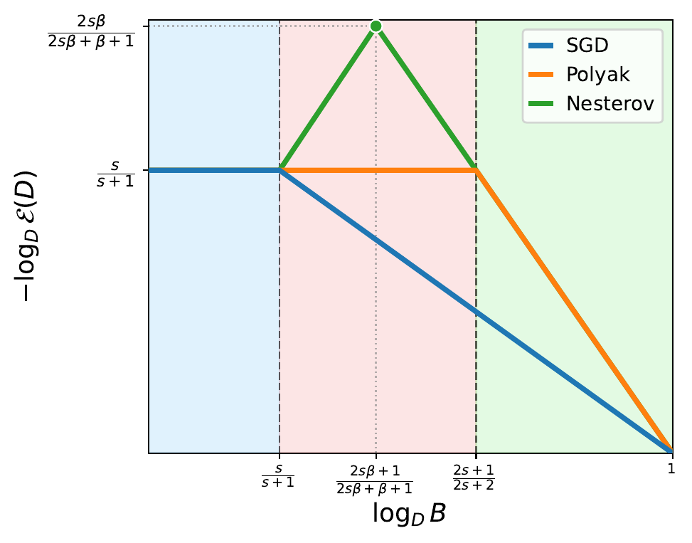
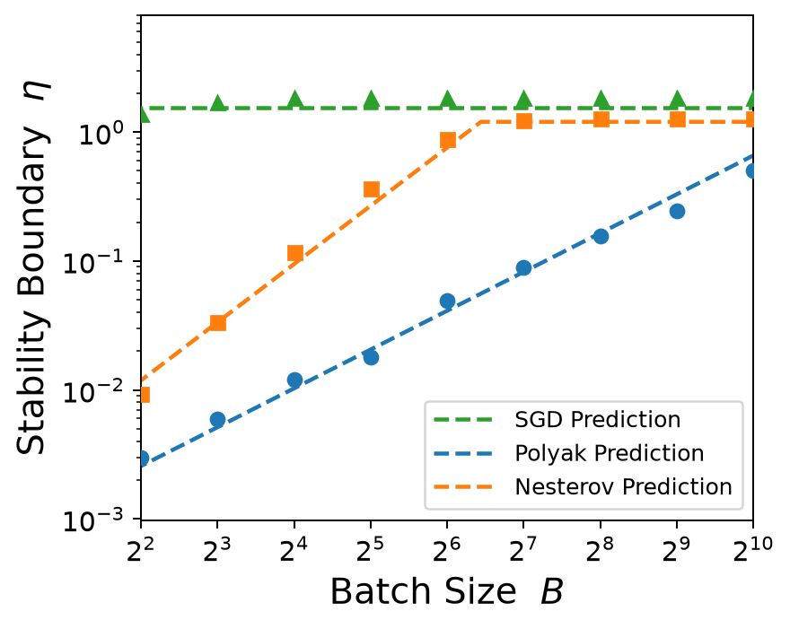
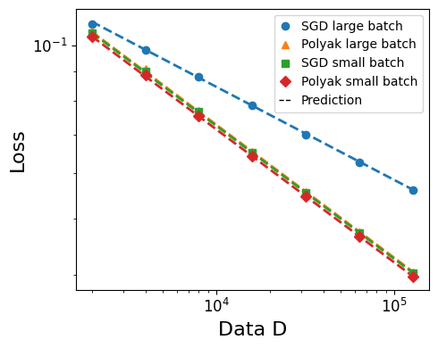
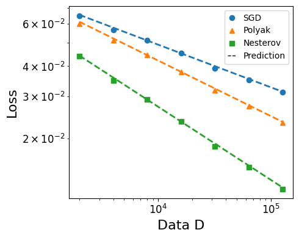

# From Polyak to Nesterov: Landscape-Aware Momentum Methods May Improve Stability and Data Scaling

<p align="center">
  <a href="#introduction">📖 Introduction</a> •
  <a href="#main-results">📊 Main Results</a> •
  <a href="#getting-started">🚀 Getting Started</a>
</p>

<a id="introduction"></a>

## 📖 Introduction

Momentum is a central ingredient in modern optimization, but its interaction with stochastic gradient noise and spectral structure is still not fully understood. Classical theory explains acceleration in deterministic settings, while offering a less complete picture of why Polyak and Nesterov momentum can behave differently in mini-batch training.

In this work, we study **SGD**, **Polyak heavy-ball momentum**, and **Nesterov momentum** in power-law kernel regression with Gaussian features. This model provides a tractable multi-scale learning problem in which the spectrum, target smoothness, gradient noise, and momentum dynamics can be analyzed together. The feature covariance spectrum and target obey

$$
\lambda_j \asymp j^{-\beta}, \qquad
\lambda_j |\theta_j^\star|^2 \asymp j^{-(1+s\beta)},
$$

where $\beta>1$ is the capacity exponent and $s>0$ is the source exponent. Smaller $s$ places more target energy in low-curvature directions and therefore corresponds to a harder learning problem.

Our analysis connects mean-square stability with data scaling under a fixed budget $D=BK$, where $B$ is the batch size and $K$ is the number of optimization steps. It shows that Polyak momentum mainly enlarges the useful batch-size range, whereas Nesterov momentum can improve the optimal data-scaling exponent through curvature-dependent damping of stochastic noise.

The repository contains the paper source and a unified PyTorch implementation of the numerical experiments. CPU, CUDA, and Apple Silicon runs share the same model and optimizer code; `--device` only selects the compute backend.

<a id="main-results"></a>

## 📊 Main Results

### 1. Stochastic Stability Boundaries

| Method | Critical learning rate |
|---|---|
| SGD | $\eta_{\mathrm{stab}}\asymp 1$ |
| Polyak | $\eta_{\mathrm{stab}}\asymp \min\{1,B(1-\rho)\}$ |
| Nesterov | $\eta_{\mathrm{stab}}\asymp \min\{1,B^\beta(1-\rho)\}$ |

Nesterov's look-ahead correction makes its stable region grow faster with batch size, allowing it to reach the deterministic stability ceiling earlier than Polyak momentum.

### 2. Data Scaling

In the presence of label noise:

- SGD achieves the optimal data-scaling rate $D^{-s/(s+1)}$.
- Polyak momentum achieves the same optimal rate but preserves it over a substantially larger range of batch sizes.
- Nesterov momentum achieves the faster rate
  $$
  D^{-\frac{2s\beta}{2s\beta+\beta+1}+o(1)}.
  $$



### Key Numerical Results

The stability experiment confirms the different batch-size dependence of the Polyak and Nesterov stability boundaries. The two scaling experiments then show that Polyak preserves the optimal rate at larger batches, while Nesterov achieves the fastest decay under a shared Nesterov-optimal batch scaling.

| Stability boundary | Polyak batch scaling | Nesterov large-batch scaling |
|---|---|---|
|  |  |  |

<a id="getting-started"></a>

## 🚀 Getting Started

### Repository Structure

```text
.
├── README.md
├── pyproject.toml              # Editable installation and CLI entry point
├── requirements.txt
├── src/momentum_scaling/
│   ├── core.py                 # Power-law problem, shared backend, and optimizers
│   ├── experiments.py          # Stability and combined scaling experiments
│   ├── scaling_experiments.py  # Focused Polyak and Nesterov scaling studies
│   ├── plotting.py             # Generates figures from saved results
│   └── cli.py                  # Unified command-line interface
├── tests/test_core.py          # Tests for the model and update equations
├── paper/                      # LaTeX source, bibliography, and original figures
├── assets/figures/             # Selected reference figures
├── assets/results/             # Numerical means from the original notebook runs
└── results/                    # New runtime outputs, excluded from version control
```

Exploratory notebooks, duplicated CPU/GPU implementations, caches, and generated files have been removed from `src/`. Reusable experiments live in the Python package, while selected paper-quality figures are stored under `assets/figures/`.

### Installation

Python 3.10 or later is required. Creating an isolated environment is recommended:

```bash
python3 -m venv .venv
source .venv/bin/activate
python -m pip install --upgrade pip
python -m pip install -e .
```

`requirements.txt` contains only NumPy, PyTorch, and Matplotlib. For NVIDIA GPUs, first install the PyTorch build that matches the local CUDA version, then run `python -m pip install -e .`.

Verify the installation with:

```bash
python -m unittest discover -s tests -v
momentum-scaling --help
```

### Quick Reproduction

The quick preset checks the environment, device selection, and complete experiment pipeline. It normally finishes quickly, but it is **not a quantitative replacement for the paper configuration**.

```bash
momentum-scaling all --preset quick --device auto --output-dir results/quick
```

The two focused scaling experiments can be run independently:

```bash
momentum-scaling polyak-scaling --preset quick --device auto --output-dir results/polyak
momentum-scaling nesterov-scaling --preset quick --device auto --output-dir results/nesterov
```

The experiments can also be run without installing the command-line entry point:

```bash
PYTHONPATH=src python -m momentum_scaling.cli all \
  --preset quick --device auto --output-dir results/quick
```

The generated files are:

```text
results/quick/
├── stability.json
├── stability.npz
├── stability.png
├── stability.pdf
├── polyak_scaling.json
├── polyak_scaling.png
├── polyak_scaling.pdf
├── nesterov_scaling.json
├── nesterov_scaling.png
└── nesterov_scaling.pdf
```

The JSON files record the configuration, device, random seed, schedules, means, standard deviations, and fitted scaling exponents. The NPZ file stores the complete stability grid and per-seed stability boundaries.

### CPU, CUDA, and Apple Silicon

```bash
# Automatic selection: CUDA, then MPS, then CPU
momentum-scaling all --preset quick --device auto

# Force CPU execution
momentum-scaling all --preset quick --device cpu --dtype float64

# Select an NVIDIA GPU
momentum-scaling all --preset quick --device cuda:0 --dtype float64

# Apple Silicon
momentum-scaling all --preset quick --device mps --dtype float32
```

MPS has limited support for `float64`. Therefore, `--dtype auto` selects `float32` on MPS and `float64` on CPU and CUDA. The paper-scale stability scan should be run on a CPU or CUDA GPU with double-precision support.

### Reproducibility Notes

- All random numbers are controlled by `--seed`.
- Deterministic seed offsets are assigned to algorithms, experiment points, and independent repetitions.
- CPU and GPU runs share the same mathematical implementation, although small floating-point differences may remain across hardware, BLAS, and CUDA versions.
- The stability experiment uses fresh Gaussian mini-batches and computes gradients in chunks to limit memory use.
- Following the paper appendix, the data-scaling experiment directly samples curvature-aligned Gaussian gradient noise.
- Each run prints the Python version, PyTorch version, device, and dtype. The same information is stored in the result JSON files.
- The `quick` preset is intended only as a smoke test. Paper-level conclusions should use the `paper` preset and 100 repetitions where specified.
