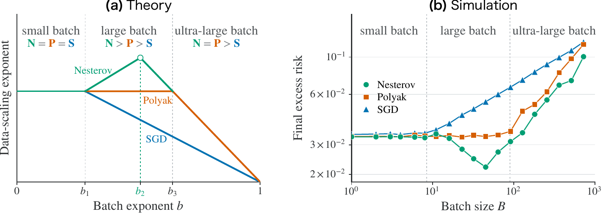
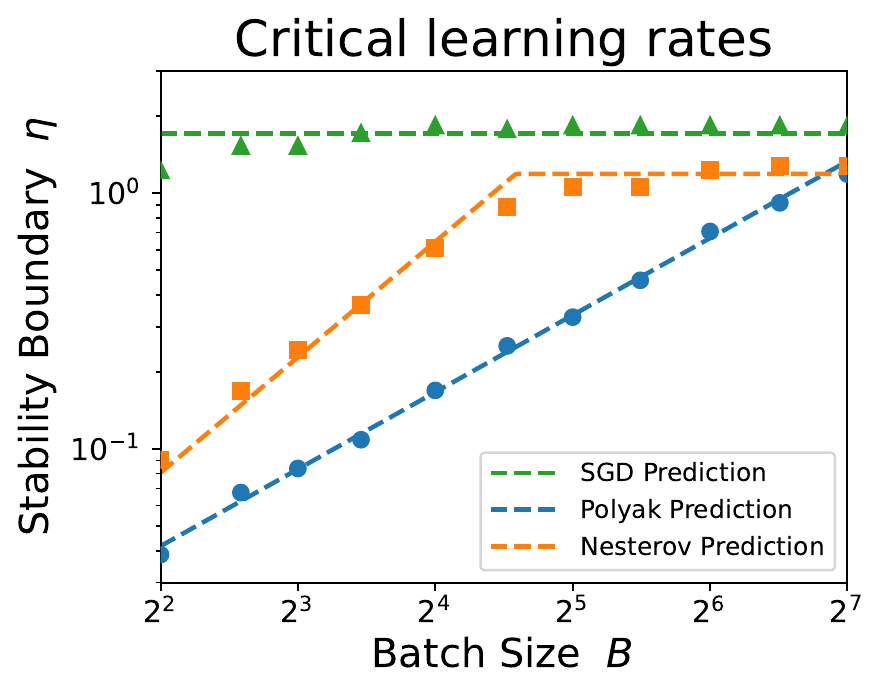
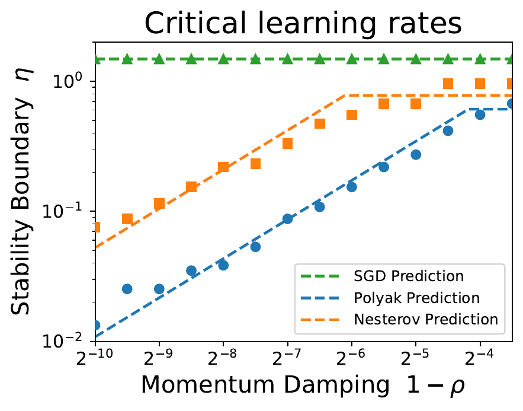
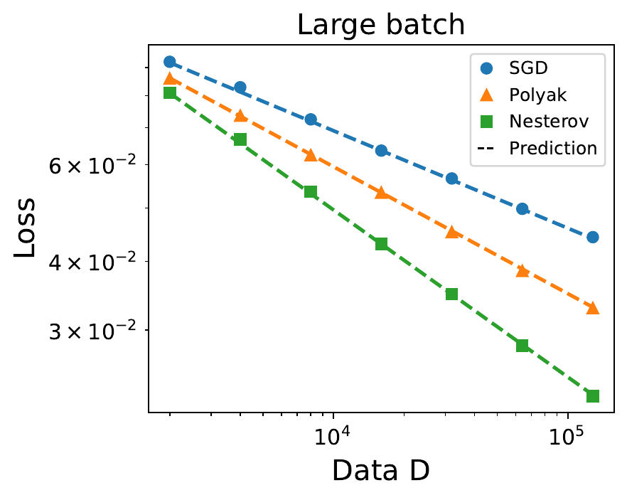
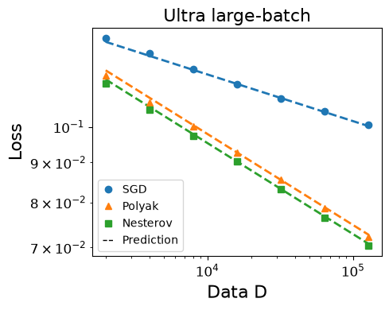
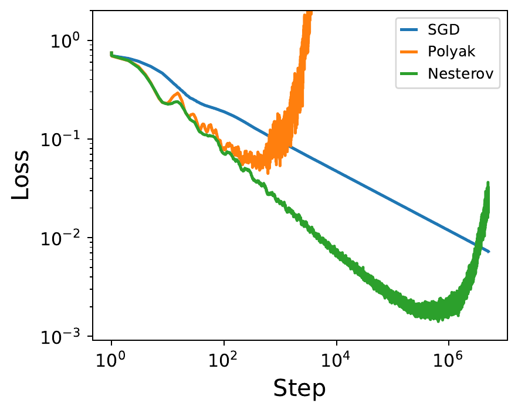

# Kernel model: theory and numerical results

[Back to repository overview](../README.md)

## 📖 Introduction

Momentum can help large-batch training in two different ways: it can preserve
data efficiency while reducing the number of sequential updates, or it can improve
data efficiency itself. We study **SGD**, **Polyak heavy-ball momentum**, and
**Nesterov momentum** in one-pass power-law kernel (PLK) regression to distinguish
these effects.

The Gaussian feature covariance and target satisfy the source and capacity conditions

$$
\lambda_j \eqsim j^{-q}, \qquad
\lambda_j |\theta_j^*|^2 \eqsim j^{-(1+sq)},
$$

where $q>1$ is the **capacity exponent** and $s>0$ is the **source exponent**.
Smaller $s$ places more target energy in low-curvature directions and makes the
problem harder. Following the paper, $\beta\in[0,1)$ denotes **momentum**,
$\eta$ is the learning rate, $B$ is the batch size, and $N=D/B$ is the number
of updates under data budget $D$. The symbol $\eqsim$ denotes equivalence up
to constant factors; the theory assumes constant-order label noise $\sigma\eqsim1$.

Our analysis follows the paper's sequence: **risk stability → risk dynamics →
optimal data scaling**. We first identify the admissible hyperparameter set
$\mathcal{A}_B$, then characterize the expected excess risk within that set,
and finally optimize the final-step risk subject to $N=D/B$. Polyak enlarges
the critical batch size while preserving the best small-batch exponent;
Nesterov's curvature-adaptive damping improves the exponent in the large-batch regime.

  

This repository contains self-contained PyTorch implementations of the numerical
experiments. The notebooks share the same update rules and automatically select
CUDA, Apple Silicon, or CPU.

## 📊 Main Results

### 1. Stochastic Stability Boundaries

Risk stability means that the expected population risk remains bounded for
every admissible initialization with finite population risk:

$$
\sup_{k\geq0}\mathbb{E}[\mathcal{R}(\boldsymbol{\theta}_k)]<\infty.
$$

Theorem 4.3 gives the following critical-learning-rate scalings for sufficiently
large $B$ and sufficiently small $1-\beta$, with constants independent of
$B$ and $\beta$.

<table align="center">
  <thead>
    <tr>
      <th align="center">Method</th>
      <th align="center">Critical learning rate</th>
    </tr>
  </thead>
  <tbody>
    <tr>
      <td align="center">SGD</td>
      <td align="center">ηcrit ≂ 1</td>
    </tr>
    <tr>
      <td align="center">Polyak</td>
      <td align="center">ηcrit ≂ min{1, B(1−β)}</td>
    </tr>
    <tr>
      <td align="center">Nesterov</td>
      <td align="center">ηcrit ≂ min{1, Bq(1−β)}</td>
    </tr>
  </tbody>
</table>

Nesterov's look-ahead correction induces curvature-adaptive damping. Before
the order-one ceiling is reached, batch size compensates for stronger momentum
as $B$ for Polyak and $B^q$ for Nesterov. Multiplicative-noise feedback governs
stability, while additive label noise sets the noise floor; the critical-rate
scalings are independent of the label-noise scale $\sigma$.

| Stability versus batch size | Stability versus momentum damping $1-\beta$ |
|---|---|
|  |  |

The batch-size and momentum-damping sweeps are the canonical stability results
for this repository. Their PDF versions are linked from the displayed figures.

### 2. Excess-Risk Scaling Laws

Following Section 3.1 of the paper, distinguish the population risk
$\mathcal{R}$ from the excess risk $\mathcal{E}$:

$$
\begin{aligned}
\mathcal{R}(\boldsymbol{\theta})
&=\frac{1}{2}\mathbb{E}_{x,y}\left[(f(x;\boldsymbol{\theta})-y)^2\right],\\
\mathcal{E}(\boldsymbol{\theta})
&=\frac{1}{2}\left\langle\boldsymbol{\theta}-\boldsymbol{\theta}^{*},
\mathbf{H}(\boldsymbol{\theta}-\boldsymbol{\theta}^{*})\right\rangle,\\
\mathcal{R}(\boldsymbol{\theta})
&=\mathcal{E}(\boldsymbol{\theta})+\frac{\sigma^2}{2}.
\end{aligned}
$$

The scaling laws describe $\mathbb{E}[\mathcal{E}(\boldsymbol{\theta}_k)]$,
where the outer expectation averages over the training randomness. Write
$\eta_\beta:=\eta/(1-\beta)$ for the effective learning rate.

For **SGD**, Eq. (13) gives, within the stable region and for $k\eta\gtrsim1$,

$$
\mathbb{E}[\mathcal{E}(\boldsymbol{\theta}_k)]
\eqsim (\eta k)^{-s}+\frac{\sigma^2}{B}\eta.
$$

For **momentum**, Theorems 5.1–5.2 assume $\eta\lesssim1$ and
$k\gtrsim\max\{\eta_\beta^{-1},(1-\beta)^{-1}\}$ and distinguish two stable
damping regimes:

| Regime | Polyak | Nesterov |
|---|---|---|
| Fully overdamped | $1-\beta\gtrsim\sqrt{\eta}$ | $1-\beta\gtrsim\sqrt{\eta}$ |
| Mixed damping | $\eta/B\lesssim1-\beta\lesssim\sqrt{\eta}$ | $\eta/B^q\lesssim1-\beta\lesssim\sqrt{\eta}$ |

In the **fully overdamped regime**, both momentum methods follow the SGD
signal–noise tradeoff with the effective learning rate $\eta_\beta$:

$$
\mathbb{E}[\mathcal{E}(\boldsymbol{\theta}_k)]
\eqsim(\eta_\beta k)^{-s}+\frac{\sigma^2}{B}\eta_\beta.
$$

In the **mixed-damping regime**, the sharp modes also contribute an underdamped
transient:

$$
\begin{aligned}
\text{Polyak:}\qquad
\mathbb{E}[\mathcal{E}(\boldsymbol{\theta}_k)]
&\eqsim \mathbb{T}_{P}(k)+(\eta_\beta k)^{-s}
+\frac{\sigma^2}{B}\eta_\beta,\\
\text{Nesterov:}\qquad
\mathbb{E}[\mathcal{E}(\boldsymbol{\theta}_k)]
&\eqsim \mathbb{T}_{N}(k)+(\eta_\beta k)^{-s}
+\frac{\sigma^2}{B}\min\left\{\eta_\beta,\eta_\beta^{1/q}\right\}.
\end{aligned}
$$

The transient envelopes satisfy

$$
0\leq\mathbb{T}_{P}(k)\lesssim\beta^k,\qquad
0\leq\mathbb{T}_{N}(k)\lesssim\min\{1,(\eta k)^{-s}\}\beta^k.
$$

These terms can be dropped only after the transient has decayed. Polyak's
mixed-regime crossover is
$\tau_\beta\eqsim(1-\beta)^{-1}\log[\eta/(1-\beta)^2]$ (Eq. (15)), so
increasing momentum also prolongs relaxation. Below the respective stability
thresholds, $1-\beta\lesssim\eta/B$ for Polyak and
$1-\beta\lesssim\eta/B^q$ for Nesterov, the dynamics are not risk stable.
All regime boundaries are understood up to constant factors.

Both methods accelerate signal learning in flat modes. Polyak preserves the
SGD signal–noise tradeoff, while Nesterov's look-ahead damping reduces the noise
floor from $\sigma^2\eta_\beta/B$ to $\sigma^2\eta_\beta^{1/q}/B$ when
$\eta_\beta\gg1$. This reduced noise amplification is the mechanism behind
Nesterov's improved data efficiency.

### 3. Data Scaling

Section 6 optimizes the final-step expected excess risk over the admissible
hyperparameters while imposing the one-pass constraint. For $B=D^{b+o(1)}$,
$b\in[0,1)$, and $N=D/B$, define

$$
\inf_{(\eta,\beta)\in\mathcal{A}_B}
\mathbb{E}[\mathcal{E}(\boldsymbol{\theta}_N)]
=D^{-r(b)+o(1)},
$$

with $\beta$ omitted for SGD. A larger $r(b)$ means better data efficiency.
The transition exponents are

$$
b_1=\frac{s}{s+1},\qquad
b_2=\frac{2s+1/q}{2s+1+1/q},\qquad
b_3=\frac{2s+1}{2s+2},\qquad
0<b_1<b_2<b_3<1.
$$

Theorem 6.3 gives the three-regime comparison, with $r_0=s/(s+1)$:

| Batch-size regime | Optimal data-scaling exponents |
|---|---|
| Small: $b\leq b_1$ | $r_{\mathrm{Nesterov}}=r_{\mathrm{Polyak}}=r_{\mathrm{SGD}}=r_0$ |
| Large: $b_1<b<b_3$ | $r_{\mathrm{Nesterov}}>r_{\mathrm{Polyak}}=r_0>r_{\mathrm{SGD}}$ |
| Ultra-large: $b\geq b_3$ | $r_{\mathrm{Nesterov}}=r_{\mathrm{Polyak}}>r_{\mathrm{SGD}}$ |

Full batch-size-dependent exponents (Theorem 6.3)

$$
r_{\mathrm{SGD}}(b)=
\begin{cases}
s/(s+1), & 0\leq b<b_1,\\
s(1-b), & b_1\leq b<1,
\end{cases}
\qquad
r_{\mathrm{Polyak}}(b)=
\begin{cases}
s/(s+1), & 0\leq b<b_3,\\
2s(1-b), & b_3\leq b<1.
\end{cases}
$$

$$
r_{\mathrm{Nesterov}}(b)=
\begin{cases}
s/(s+1), & 0\leq b<b_1,\\
\dfrac{s(1+(q-1)b)}{sq+1}, & b_1\leq b<b_2,\\
2s(1-b), & b_2\leq b<1.
\end{cases}
$$

Polyak enlarges the critical batch size from $D^{b_1+o(1)}$ to
$D^{b_3+o(1)}$ while retaining the best small-batch rate $D^{-s/(s+1)+o(1)}$.
Nesterov attains its best rate $D^{-2sq/(2sq+q+1)+o(1)}$ at $b=b_2$.
The finite training horizon matters: increasing momentum must still leave time
for the transient to decay within $N=D/B$ updates. This is why stability alone
does not determine the critical batch size.

| Small batch | Large batch | Ultra-large batch |
|---|---|---|
|  |  |  |

### Key Numerical Results

The archived kernel experiments are organized into four experiment types:

1. **Stability** scans recover the different dependence on $B$ and $1-\beta$.
2. **Loss-dynamics** runs recover the transient-to-scaling transition and the distinct Polyak and Nesterov noise floors across six $(s,q)$ settings.
3. **Scaling** runs recover the predicted small-, large-, and ultra-large-batch exponents, while a fixed-$D$ sweep shows the shift in the best batch size.
4. **Blowup** runs stress-test the optimizers under an explicitly time-varying momentum schedule.

#### Scaling-law fits across six PLK settings

The $2\times3$ sweep uses $s\in\{0.3,0.5\}$ and $q\in\{2,4,6\}$. Pale curves show the mean population excess risk and solid curves show the fitted theoretical total. The time dependence of the transient, signal, and noise terms is fixed by theory; only nonnegative $O(1)$ coefficients are fitted.

The fits track both the oscillatory transient and the algebraic regime. For $s=0.5$, the late-time curves also expose Nesterov's lower noise floor increasingly clearly as $q$ grows.

#### Time-domain transitions

The saved scans track the transition from underdamped transients to algebraic
decay. The dominant damping timescale is $(1-\beta)^{-1}$, with the logarithmic
factor in $\tau_\beta$ retained above. Nesterov's curvature-adaptive damping
suppresses its transient envelope and lowers the noise floor in the mixed regime.

#### Data scaling across three batch-size regimes

For $(s,q)=(0.3,4)$, all three methods share the same small-batch exponent. Nesterov is fastest in the large-batch regime, while Polyak and Nesterov share the same exponent once the batch is ultra-large. In the large-batch run, the theoretical/measured exponents are $0.1772/0.1787$ for SGD, $0.2308/0.2321$ for Polyak, and $0.3039/0.3074$ for Nesterov.

#### Fixed-budget batch size

At fixed $D=2^{14}$, Nesterov attains the lowest loss and shifts the best batch size upward.

#### Increasing-momentum blowup

  

Under $\beta_k=1-1/(k+1)$, Polyak eventually becomes unstable, whereas Nesterov remains stable over the saved 500,000-step horizon.
